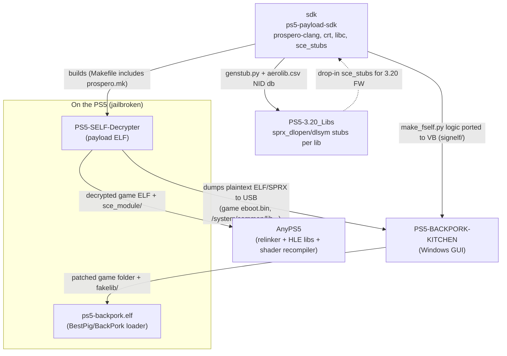
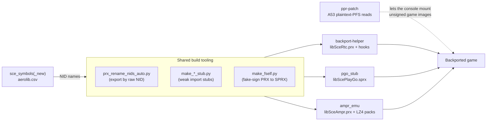

# Reference projects: overview

Survey of `.original/reference/` (5 projects, about 4,200 files and 115 MB). The goal is to understand what each project does and how they connect, before we reverse engineer and rework the backport tooling.

| Folder | Upstream (git remote) | Language | Size | Role |
|---|---|---|---|---|
| `sdk/` | `ps5-payload-dev/sdk` (John Törnblom) | C, LLVM toolchain | ~2,000 files | Toolchain for building **payloads** (homebrew ELFs) that run on a jailbroken PS5 |
| `PS5-SELF-Decrypter/` | `idlesauce/PS5-SELF-Decrypter` (originally SpecterDev) | C payload | 13 files | Runs **on the console** and uses a kernel R/W exploit to decrypt real SELF/SPRX files to plain ELF |
| `PS5-3.20_Libs/` | `DNNDHH/PS5-3.20_Libs` | Generated C | 275 `.c` files, ~318k lines | **Import stubs** for every 3.20-firmware system library, generated with the sdk's `genstub.py` |
| `PS5-BACKPORK-KITCHEN/` | `rajeshca911/PS5-BACKPORK-KITCHEN` (discontinued) | VB.NET WinForms, .NET 8 | ~230 files | Windows GUI that **backports** a decrypted PS5 game to a lower firmware: SDK-version patch, fake-sign, add fakelibs |
| `AnyPS5/` | `boykopovar/AnyPS5` (2,477 commits, active) | C++20, CMake | ~1,600 files (submodules not checked out) | Converts a PS5 game ELF into a **native Linux/Windows executable**, with reimplemented system libraries and a GPU shader recompiler |
| `backport-helper/` | `drakmor/backport-helper` | C++, MSBuild (official Prospero SDK) | 19 files | Template **replacement `libSceRtc.prx`** that adds missing exports and installs runtime hooks, built in one variant per SDK (4–13) |
| `pgo_stub/` | `drakmor/pgo_stub` (v0.5) | C++, MSBuild (official Prospero SDK) | 11 files | **Replacement `libScePlayGo`** that reports every chunk as installed |
| `ampr_emu/` | `drakmor/ampr_emu` | C++, Makefile (payload-sdk) and MSBuild | 124 files | **Software `libSceAmpr`** (AMPR/APR/AMM command buffers on top of AIO), plus an LZ4 asset-pack system |
| `make_fself/` | `drakmor/make_fself` | Python | 1 script | `make_fself_batch.py`: sdk `make_fself.py` extended with batch signing, unpacking and repair |
| `ppr-patch/` | `drakmor/ppr-patch` | C payload and AArch64 asm | 25 files (**incomplete**, see below) | Patches the **A53 storage-controller firmware** so plaintext, unauthenticated PFS images can be mounted |
| `sce_symbols/` | `drakmor/sce_symbols` (fork) | Data | 18 files, 62 MB | NID-to-name database (`aerolib.csv`) for PS3/PS4/PS5/PSP/Vita |
| `BackPork/` | `BestPig/BackPork` | C payload | 5 files + 12 patches | Original fakelib loader (unionfs over sandbox `common/lib`) plus BPS patches for 10.01 libraries → 6xx/7xx; see [Part 6](#part-6-firmware-export-lists-step-2-research-results) |
| `ShadowMountPlus/` | `drakmor/ShadowMountPlus` | C payload (payload-sdk) | ~150 files | Auto-mounts game dumps and **overlays `fakelib/` into the game sandbox**; replaces `ps5-backpork.elf`. See [Part 4](#part-4-shadowmountplus-the-runtime-that-loads-fakelibs). |
| `sce_symbols_new/` | `zecoxao/sce_symbols` (upstream) | Data | 18 files, 62 MB | Same database, with 4,583 more PS5 names; a strict superset of `sce_symbols/` |

> Note: `.original/` also holds `GT7/` (`USA`/`EUR` = GT7 backported to FW 4, `NOT_BACKPORT`/`decrypted` = before) and `CONTROLResonant/backport` (a second game, FW 4.03; [Part 7](#part-7-control-resonant-second-backport-sample)). They are compared in [Part 3](#part-3-gt7-171-before-and-after-the-backport).
> The last seven rows were added later. They are covered in [Part 2](#part-2-drakmor-backport-toolkit).

---

## Relationship map



Two separate **output paths** start from the same decrypted game files:

1. **Backport path (stays on the PS5):** decrypt, then rewrite the SDK version in the ELF, fake-sign it back to SELF, and ship the newer system libraries (fakelibs) alongside. The game then runs on older firmware through `ps5-backpork.elf`.
2. **Port path (leaves the PS5):** decrypt, then relink the ELF for the host OS and replace every system library (`libkernel`, `libSceAgc`, ...) with a native implementation. The game runs as a normal PC process.

### What the projects share

- **NIDs.** PS5 symbols are imported by an 11-character NID, not by name: `SHA1(name + 518D64A635DED8C1E6B039B1C3E55230)`, take the first 8 bytes reversed, then encode them with a custom base64 alphabet (`+-`). The same algorithm appears in:
  - `sdk/host/bin/prospero-nid.c` and `sdk/crt/nid.c`
  - `AnyPS5/core/libs/nid/src/NidCompute.cpp` and `AnyPS5/tools/nid_names.py`
  - the generated stubs in `PS5-3.20_Libs` (for example `sprx_dlsym(h, "kW3GLb7QfPg", &__ptr_sceAgcInit)`)
- **Name database.** `zecoxao/sce_symbols/aerolib.csv` (NID to name) is used by `sdk/sce_stubs/Makefile` and by `AnyPS5/tools/nid_names.py`.
- **SELF format.** Magic `0x1D3D154F` (Orbis/PS4) and `0xEEF51454` (Prospero/PS5), a 0x20-byte header, and 0x20-byte segment entries with flag bits (encrypted, signed, compressed, has blocks/digests/blockinfo). It is defined in:
  - `PS5-SELF-Decrypter/include/self.h` (real decryption on the console)
  - `PS5-BACKPORK-KITCHEN/.../Services/SelfUtilCode/SelfFile.vb` (SelfUtil port: unwraps an already-decrypted or fake SELF into an ELF)
  - `PS5-BACKPORK-KITCHEN/.../signelf/*.vb` (port of `sdk/samples/install_app/make_fself.py`: wraps an ELF into a fake-signed SELF)
- **SCE program headers.** `PT_SCE_PROCPARAM = 0x61000001` (magic `ORBI`, `0x4942524F`) and `PT_SCE_MODULE_PARAM = 0x61000002` (magic `0x3C13F4BF`). The PS4 SDK version sits at param+0x10 and the PS5 SDK version at param+0x14. Backpork patches these fields, and AnyPS5's `ElfReader` parses the same headers.
- **Library set.** The libraries AnyPS5 reimplements (`core/libs/prx/*`, 115 of them) are a subset of the libraries stubbed in `PS5-3.20_Libs` (275 of them). The 3.20 list is a useful checklist of the full PS5 system-library surface.

---

## 1. `sdk/`: ps5-payload-sdk

**What it is:** the de-facto open SDK for PS5 homebrew payloads. The resulting ELFs are sent to an ELF loader (elfldr, websrv, BD-J, the Lua loader) on an exploited console.

| Path | Contents |
|---|---|
| `host/bin/prospero-*` | Wrappers around clang/lld/cmake/meson/pkg-config targeting `x86_64-sie-ps5`; `prospero-deploy` sends an ELF to `PS5_HOST:PS5_PORT` (9021) |
| `host/toolchain/prospero.{mk,cmake,ini,sh}` | Build-system integration; projects `include $(PS5_PAYLOAD_SDK)/toolchain/prospero.mk` |
| `host/win/` | Windows `.cmd` wrappers |
| `crt/` | Payload runtime: `_start.S`, the in-payload dynamic linker (`rtld*.c`, which loads `.sprx` via `sceKernelLoadStartModule` and resolves symbols by NID), kernel R/W helpers (`kernel.c`, `kernel_iommu.c`, `kernel_procio.c`), `klog`, `mdbg`, `patch.c` |
| `include/ps5/` | Public API: `kernel.h` (kernel R/W, FW version, auth IDs), `klog.h`, `mdbg.h`, `nid.h`, `payload.h`, `iommu.h` |
| `include/freebsd`, `libc/`, `libufs/` | FreeBSD headers, extra libc functions missing from the console libc, and a UFS library |
| `sce_stubs/` | `genstub.py` reads a decrypted `.sprx` and emits a `.c` stub; 30 stub libs are prebuilt (libkernel, libSceNet, libScePad, ...) |
| `samples/` | 23 examples. The most relevant: `install_app/make_fself.py` (fake-sign ELF to SELF), `hello_sprx`, `hello_dlfcn`, `relocatable_linking` |

**Why it matters for us:** this is the toolchain that builds the decrypter and any new on-console tooling, and `make_fself.py` is the reference for fake signing.

## 2. `PS5-SELF-Decrypter/`

**What it is:** a payload (built with the sdk) that decrypts signed executables on the console and dumps plaintext ELFs to `/mnt/usb0/PS5/` (or `/data/dump`).

How it works (`source/`, about 1,700 lines):
- `main.c`: picks a `tailored_offsets` set from `kernel_get_fw_version()`. FW 3.00 through 10.xx are covered (3.xx, 4.xx, 5.0x, 5.5x, 6.xx, 7.0x, 7.2–7.61, 8.xx, 9.xx, 10.xx). It then walks a dump queue, and for each file:
  1. verifies the SELF header with the AuthMgr,
  2. decrypts each segment's block-info,
  3. decrypts block by block,
  4. rebuilds the ELF.
  It resumes after a kernel panic.
- `sbl.c`: talks to the Secure Boot Loader (SAMU) mailbox using kernel R/W. Translates VA to PA through a page-table walk (`pmap_kextract`) and sends `sceSblServiceRequest` messages.
- `authmgr.c`: AuthMgr service calls: `VerifyHeader`, `LoadSelfSegment`, `LoadSelfBlock`, `SmFinalize`.
- `include/self.h`, `elf.h`, `sbl.h`, `authmgr.h`: format and message structs.

Build variants (Makefile `make dist`): default, `-sock-log` (logs to `PC_IP:PC_PORT`), `-system-common-lib` (`/system/common/lib`), `-full-system` (`/system` and `/system_ex`), `-shellcore`, and `-game` (the running title).

The README documents how to find the 11 kernel `.data` offsets for a new firmware from nearby strings (`"sdt"`, `"SblDrvSendSx"`, `"req mtx"`, `"invlgn"`, `"pmap"`, and so on).

**Why it matters for us:** this is the first step for both paths. It produces the plaintext game ELF and the plaintext system SPRX files (fakelib sources, and the reference for library behaviour).

## 3. `PS5-3.20_Libs/`

**What it is:** one generated `.c` file per system library on firmware 3.20, from `gaikai-player` through `libSceXXX` to `libkernel*`. A header says each file was generated by `genstub.py`, which is the sdk tool.

Each file:
- declares `__ptr_<func>` and an asm trampoline `<func>: jmp [rip + __ptr_<func>]` for every export,
- has a `constructor(104)` that runs `sprx_dlopen("<lib>")` and then `sprx_dlsym(handle, "<NID>", &__ptr_<func>)` for each export,
- has a `destructor` that runs `sprx_dlclose`.

**Why it matters for us:** it gives the complete export list (name and NID) of every 3.20 library. That is a ready-made **NID to name table**, which is useful to diff library exports between firmwares (what a fakelib must provide) and to label imports in Ghidra.

## 4. `PS5-BACKPORK-KITCHEN/`

**What it is:** a WinForms GUI (`net8.0-windows`; FluentFTP, Newtonsoft.Json, ReaLTaiizor UI, SharpCompress, SQLite) that automates BestPig's **BackPork** method plus idlesauce's downgrade script. The README marks it **discontinued**.

### Core backport flow ("Start Cooking", `Form1.vb` `BtnStart_Click`)
1. Back up the folder, then remove any old `fakelib/` from the game folder.
2. `PatchingCoordinator` walks every `eboot.bin`, `*.prx` and `*.sprx` and calls `PatchElfSmart` (`core/ElfReader.vb`):
   - If the file is already a plain ELF, patch it in place.
   - Otherwise unwrap the SELF to a temp ELF (`selfutilmodule.unpackfile`, an internal SelfUtil port), patch it, **fake-sign** it (`SignSingleElf`, from `signelf/`), and copy it back.
   - Optional "6xx" fix: in `libc.prx`, replace the string `4h6F1LLbTiw#A#B` with `IWIBBdTHit4#A#B` (an import NID swap).
3. **The patch itself** (`core/ElfPatcher.vb`): find the `PT_SCE_PROCPARAM` or `PT_SCE_MODULE_PARAM` segment, check its magic, and overwrite the PS5 SDK (+0x14) and PS4 SDK (+0x10) with the target pair from `core/VersionProfiles.vb`. Files already at or below the target are skipped.

   | FW | PS5 SDK | PS4 SDK |
   |---|---|---|
   | 1 | `0x01000050` | `0x07590001` |
   | 2 | `0x02000009` | `0x08050001` |
   | 3 | `0x03000027` | `0x08540001` |
   | 4 | `0x04000031` | `0x09040001` |
   | 5 | `0x05000033` | `0x09590001` |
   | 6 | `0x06000038` | `0x10090001` |
   | 7 | `0x07000038` | `0x10590001` |
   | 8 | `0x08000041` | `0x11090001` |
   | 9 | `0x09000040` | `0x11590001` |
   | 10 | `0x10000040` | `0x12090001` |
4. Copy `<exeDir>/<FW>/fakelib/*` into `<game>/fakelib/`. Fakelibs are newer-firmware SPRX files (for 7.xx: `libSceAgc`, `libSceAgcDriver`, `libSceNpAuth`, `libSceNpAuthAuthorizedAppDialog`, `libSceSaveData.native`, plus `ps5-backpork.elf`). Their download list is `fakelibs.json`; the URLs are base64-encoded.
5. On the console, run `ps5-backpork.elf`, which sideloads `fakelib/` in place of the system libraries.

`PatchPipeLineRules-Important.txt` defines the required order: detect type, decrypt, validate, check SDK, patch header, optional libc patch, sign, then atomically replace the original.

### Other modules (mostly extra tooling)
- `core/PKG/` builds fake PKGs (`FPKGBuilder`, `SFOBuilder`, `PKGReader`/`Writer`).
- `core/UFS2/` and `Services/UFS2*` read and build UFS2 images (shells out to UFS2Tool).
- `Services/Firmware*` download PUPs and unpack them with `tools/pup_unpacker.exe` and `ps5_pup_decrypt.elf`.
- `Services/Ftp*`, `PayloadSender*`, `RemotePkgInstall*` talk to the console over the network.
- `Services/SigningService.vb` supports three signing modes: FreeFakeSign, NPDRM, and CustomKeys.
- `Services/GameSearch/*` contains torrent and DDL search providers. These are not relevant to us.
- `Architecture/` is a partial clean-architecture refactor (coordinators, `Result` type, adapters).

**Why it matters for us:** it is the most direct description of the backport recipe (SDK fields, fakelibs, fake sign). The VB code is readable but tightly coupled to `Form1`.

> Deep dive into the actual backport pipeline, its limits and bugs: [Part 9](#part-9-how-backpork-kitchens-general-backport-actually-works-deep-dive).

## 5. `AnyPS5/`

**What it is:** a static **relinker**: a PS5 game ELF becomes a native Linux ELF or Windows PE, with no emulator. The x86-64 game code runs directly, and system calls go to native reimplementations of the PS5 libraries. The project is GPL-2.0. It is verified with *Dreaming Sarah* (PPSA02929) at 60 fps.

Pipeline (`core/relinker/main.cpp`):
1. `--to-intel` (optional, `codegen/x86/*`): rewrite instructions that exist only on AMD Zen 2 (SSE4a, CLZERO, SHA, `VRCPPS`/`VRSQRTPS` precision) in place, or through trampolines.
2. `RelinkerPipeline`: read imports by NID, scan for raw `syscall` instructions, optionally filter unused NIDs (`unused-filter=0/1/2`), and build a SysV `.dynamic` section.
3. `GuestModuleBuilder`: convert the bundled `sce_module/*.prx` files the same way.
4. `LinuxElfPatcher` or `WindowsPePatcher`: emit the final executable (on Windows, with `sce_sys/icon0.png` as the icon).

Runtime layout: `app.elf|app.exe`, then `libs/*.prx` (the native libraries), then `app0/` (game data plus converted `sce_module/`).

Key directories:
- `core/libs/prx/<lib>/`: 115 HLE libraries. Exports use the `APS5_VABI` calling convention, or `APS5_EXPORT("<nid>", fn)` when only the NID is known. The large ones are `libkernel` (memory, pthreads, files, equeue, sockets, modules), `libc`, `libSceAgc`/`libSceAgcDriver` (PM4 command buffers to Vulkan), `libSceVideoOut`, `libSceAudioOut`, `libScePad`, and `libSceSaveData`.
- `core/libs/nid/`: `nid_patcher`, which renames compiled exports to their NIDs after the build (ELF and PE).
- `core/shader/recompiler/`: RDNA2 GCN ISA to SPIR-V, in the stages `RdnaDecoder`, `ControlFlow`, `Translation` (IR), `Optimization` (SSA, SRT walker), and `SpirvBackend`. Results are cached on disk.
- `core/Decoder/{Png,Jpeg}`: image decoders used by the `libScePngDec` and `libSceJpegDec` implementations.
- `tools/`: `nid_names.py` (checks names and NIDs against aerolib), `progress.py` (coverage badges), `hw-oracle/` (runs RDNA instructions on real hardware to check the recompiler), and `rdna_isa.txt`.
- `docs/dev/TechnicalDebt.md` lists every silent stub. These are worth reading because they show which library behaviours a game can survive without.
- `3rdparty/` submodules (SDL2, Vulkan, glslang, SPIRV, VMA, ffmpeg, freetype, LibAtrac9, stb, libjpeg-turbo) are **empty**. Building needs `git submodule update --init --recursive`.

**Why it matters for us:** it is the best documentation available of how PS5 ELFs are laid out (dynamic tags, NID imports, module params) and of what each system function does. Its `ElfReader`, NID tooling and per-library `Export.cpp` files are a strong reference for any backporting work, especially for writing **shim/fake libraries** that cover functions missing on older firmware.

---

## Part 2: drakmor backport toolkit

Six of the seven new folders come from one author (`drakmor`). Together they form a newer and more principled backport approach than Backpork Kitchen. Backpork ships whole newer-firmware SPRX files. This toolkit **writes small replacement libraries** that provide only what the game needs, and **patches the console** so it accepts unsigned, plaintext game data.



### `backport-helper/`: replacement-library template (`libSceRtc`)
- It is a complete `libSceRtc` reimplementation (`rtc.cpp`) that **also** exports functions an older firmware lacks. `backports.cpp` gates them with `#if BACKPORT_SDK <= N`; the shipped example is `sceKernelGetOperationMode` for SDK ≤ 10.
- `libSceRtc` is only the host. Almost every game loads it, which makes it a convenient carrier for exports and hooks that belong to other libraries.
- **Hook engine** (`hooks.cpp`, using the HDE64 disassembler): it detours function prologues, builds trampolines that relocate RIP-relative instructions, and installs from `module_start` with rollback. It has two kinds of hook:
  - `g_backportHooks[]` for imports that are already bound, for example a `sceKernelGettimezone` fallback to UTC.
  - `g_lateDlsymHooks[]` for modules loaded later. These are caught by hooking `sceKernelLoadStartModule` and resolved with `sceKernelDlsym`.
- **Tools:**
  - `prx_rename_nids_auto.py` rewrites exported NIDs in `.dynstr` and rebuilds the SysV `.hash`. This lets you export a function whose name is unknown, using a raw-NID map in `tools/nidmaps/`.
  - `make_kernel_extra_stub.py` and `make_libc_internal_stub.py` emit weak `ET_SCE_STUBLIB` import archives for symbols the official SDK stubs don't include.
- **Build:** Visual Studio with the **official Prospero SDK platform** (`<_rtc.h>`, `save_data/save_data_api.h`). It cannot be built with the open payload-sdk as-is. `Release` produces `out/sdk4…sdk13/libSceRtc.prx`.

### `pgo_stub/`: `libScePlayGo` replacement
- It implements 24 `scePlayGo*` exports with optimistic answers: initialized, every chunk at locus "local fast", install complete, every language available.
- Optional `/app0/playgo_stub.dat` sets the chunk count or list, the scenario count, and the language mask (names, IDs, or a `0x` hex mask). The `ReleaseLog` build writes `/app0/playlgo.log`. Note the "lgo" typo in that filename.
- A post-build step runs `tools/make_fself.py` to produce a fake-signed `.sprx`. The sources use only libc headers, but the project is still MSBuild/Prospero only.

### `ampr_emu/`: software `libSceAmpr`
- AMPR is the PS5's asynchronous I/O and memory-mapping command-buffer API: **APR** reads files into memory and **AMM** maps memory. `src/sceampr_exports.cpp` implements about 120 exports (`sceAmprCommandBuffer*`, `sceAmprAprCommandBuffer*`, `sceAmprAmm*`, ...). It runs them in software with an APR reactor and an equeue bridge, on top of `sceKernelAioSubmitReadCommandsMultiple` and `sceKernelApr*`, which are hooked in libkernel.
- **Asset packs:** a second feature compresses `/app0` into seekable LZ4 packs (`AMPRPAK4`, index `AMPRIDX3`, runtime config `AMPRCFG1`). Reads are optionally intercepted process-wide (`open/read/pread/AIO`). The workflow is: record traces (`ampr_commands.bin`), profile them into TOML (`tools/ampr_pack_profile.py`), pack (`tools/ampr_pack.py`, or the GUI), and verify. Its purpose is to shrink games so they fit.
- **Build:** this is the only drakmor project with an open-toolchain build. The `Makefile` uses ps5-payload-sdk with its own CRT (`ps5/crt`), a linker script (`ps5/prx/prx.script`), and NID/hash fix-up tools. A CI workflow is included. `libSceAmpr.sln` provides the official-SDK build.
- `tests/` contains on-console smoke, stress, negative and PRX-boundary tests.

### `make_fself/`
- `make_fself_batch.py` is a superset of `sdk/samples/install_app/make_fself.py`. It adds:
  - directory batch signing in place,
  - `--unpack` (SELF/FSELF to ELF, with `.selfbak` backups),
  - repair of incomplete `.sceversion` records,
  - automatic derivation of PAID and ptype.
- For our work, this is the most useful signer.

### `ppr-patch/`: A53 plaintext PFS reads
- The A53 is an ARM core in the storage path (MP4, "PPR"). Normally every 64 KiB package read goes through `zcnDriverAddCommandsPackageDecryptToZcnBufferAndVerifySign` (AES-XTS plus SHA3-CMAC).
- The payload redirects the **ten** callers of that helper to a wrapper. The wrapper switches to `PLAINTEXT_NOAUTH` only when the kernel passes the exact key-index pair `AES=0xff, SHA=0xfe`; every other read stays native.
- It has 55 layout profiles covering 89 firmware/target mappings (1.00–11.40, retail/testkit/devkit). It fails closed on anything unknown and requires `--idle`.
- A separate `a53_kmb_range_*` payload removes the opcode-0x53 key-slot whitelist check.
- Its doc says the matching **kernel-side** marker is not part of this repo. Something else has to set `0xff/0xfe` for plaintext mounts.

### `sce_symbols/` and `sce_symbols_new/`
- Both use the same format: `aerolib.csv` (`<NID> <name>`), the `*_names.txt` lists, and the `*_names2nid.py` generators.
- `sce_symbols_new` is the **current upstream** and contains every line of the drakmor fork, plus 4,583 hash-verified PS5 names across 167 libraries.
- AnyPS5's `nid_names.py` pins upstream commit `2883963`, which is exactly the `sce_symbols_new` HEAD.

### Review findings

| # | Severity | Finding |
|---|---|---|
| 1 | **High** | **`ppr-patch` is incomplete.** The `Makefile` needs `kmb_range_main.c`, `kmb_range_patch.{c,h}`, `kmb_range_patch_test.c`, `kmb_range_profiles.inc`, `generate_kmb_range_profiles.py` and `verify_kmb_range_profiles.py`. None of them are in the repo, and the build's dependency rules list `kmb_range_patch.h`, so `make` / `make all` (which runs `verify` and `host-test` first) will fail. The `a53_ppr_*` sources are present, but extracting them requires editing the Makefile. `make profiles` and `make verify` also need the private `PPR_ROOT` archive of A53 images, which is not included. |
| 2 | Medium | **`backport-helper` and `pgo_stub` build only with the official Sony Prospero SDK** (MSBuild platform, SDK headers such as `<_rtc.h>`). With only ps5-payload-sdk, they need porting first. `ampr_emu`'s Makefile, CRT and linker script show how to do that port. |
| 3 | Low | **Latent bugs in upstream `make_fself.py`** (identical in `sdk/` and `pgo_stub/tools/`, also present in `make_fself_batch.py`): (a) `is_intervals_overlap` compares `p1[1] <= p2[0]` instead of `p2[0] <= p1[1]`; (b) `segment_index` is declared with `@wbits.setter`, so **reading** `segment_index` returns `wbits`. Neither breaks signing today: the function is never called, the property is only written, and the batch tool reads `props` directly. `ampr_emu/tools/make_fself.py` fixes both, so use it as the base copy. |
| 4 | Low | **Duplication across repos:** 4 copies of `make_fself`, 2 diverged copies of `hde64.cpp` (backport-helper and ampr_emu), and 2 independent pairs of `make_*_stub.py`. A shared tools folder would avoid drift. |
| 5 | Low | `sce_symbols/` is redundant. Use `sce_symbols_new/` everywhere; `sdk` and AnyPS5 already point at upstream. |
| 6 | Info | Doc issues: `ampr_emu/README.md` is two lines (the real docs are in `docs/`). `ppr-patch/README.md` links `../PPR_READ_PATHS.md`, but the file is in the same folder. The pgo_stub log name is `playlgo.log`. |

### Where this fits in the overall picture
- Backpork Kitchen's **SDK-field patch and fake signing** are still required, and `make_fself_batch.py` replaces Backpork's VB signer.
- Backpork's **whole fakelib SPRX files** can be replaced by small purpose-built shims: `pgo_stub`, `ampr_emu`, and `backport-helper`-style libraries that export missing NIDs or hook failing calls. AnyPS5's `core/libs/prx/*` is a good reference for writing such shims.
- `ppr-patch` covers the separate problem of **mounting unsigned or plaintext game images** on the console.

---

## Part 3: GT7 1.71, before and after the backport

Two copies of **Gran Turismo 7** (`PPSA01317`, content ID `UP9000-PPSA01317_00-GRANTURISMO70000`, version `01.710.000`) are available. Comparing them byte by byte shows exactly what a backport changes.

| Folder | Role | SDK fields in the binaries |
|---|---|---|
| `.original/NOT_BACKPORT/` | **Before**: the original, not backported (confirmed by the user) | `0x10000040` / `0x12090001`, the same values as Backpork's **FW 10** pair |
| `.original/GT7/USA/` | **After**, backported to **FW 4.xx** | `0x04000031` / `0x09040001`, which is exactly Backpork's **FW 4** pair |

> ✅ **Confirmed by the user:** NOT_BACKPORT is **not** a backport, and **both copies run on a PS5** (each on its intended firmware). So every patch listed below is known to work in practice.
>
> **SDK values are not the same thing as the firmware requirement.** The original binaries carry SDK `0x10000040` / `0x12090001`, while `param.json` says `sdkVersion 0x13…` and requires FW 13.60. The SDK values in the binaries record which SDK the game was compiled with; the package-level `param.json` sets the firmware the console requires. Backpork's FW 10 pair is therefore simply real values taken from shipped games. Don't use the binaries' SDK fields to guess a game's firmware requirement; read `param.json`.
>
> NOT_BACKPORT's `fakelib/` contains `libSceAmpr` and `libScePlayGo`. *(Correction 2026-10-08: on disk `libSceAmpr.sprx` is **0 bytes** (dated 2026-06-26); only `libScePlayGo.sprx` is byte-identical to the FW 4 copy. Tools see the empty file as kind `unknown`; `backport` replaces it with the store's `libSceAmpr.sprx`.)* **These are not part of a backport.** They were added so the game runs under **ShadowMount** with **`ampr_emu`** (confirmed by the user). So the AMPR/PlayGo replacements are a requirement of running the game from a ShadowMount mount, on any firmware; the backport's own additions are only `libSceAgc`, `libSceAgcDriver`, `libScePsml`, `k9.psp` and `ampr_emu.index`.
>
> ShadowMountPlus is now in `reference/` and covered in [Part 4](#part-4-shadowmountplus-the-runtime-that-loads-fakelibs). It skips these replacements for real installed packages, so they are only needed when running from a dump.

### Files

| Path | NOT_BACKPORT | GT7/USA (FW 4) | What it is | Ghidra |
|---|---|---|---|---|
| `eboot.bin` (105 MB) | PS5 SELF `0xEEF51454` | PS4-style SELF `0x1D3D154F` | Main executable (ELF type `0xFE10`, `ET_SCE_EXEC`; internal name `application_gt7`) | Yes, unwrapped |
| `libSieRdNNabla.prx` (30 MB) | PS5 SELF | PS4-style SELF | Game library; the name suggests Sony's "Nabla" neural-network runtime (probably the AI driver) | Yes, unwrapped |
| `logiWheel.prx` (330 KB) | PS5 SELF | PS4-style SELF | Game library: Logitech steering-wheel support | Yes, unwrapped |
| `sce_module/libc.prx`, `libScePfs.prx`, `libSceNpCppWebApi.prx` | PS5 SELF | PS4-style SELF | Libraries bundled with the game (SELF containers despite the `.prx` extension) | Yes, unwrapped |
| `sce_sys/about/right.sprx` | PS5 SELF | PS4-style SELF | Standard rights module (ELF header ABI-version byte is 3; the others have 2) | Yes, unwrapped |
| `fakelib/libSceAmpr.sprx`, `libScePlayGo.sprx` | present | present, **byte-identical** | Software AMPR (`ampr_emu`) and PlayGo replacements (SDK `0x02000009`), needed to run under **ShadowMount** rather than for the backport | Yes, unwrapped |
| `fakelib/libSceAgc.sprx`, `libSceAgcDriver.sprx` | absent | PS5 SELF, fake-signed | Replacement GPU libraries | Yes, unwrapped |
| `fakelib/libScePsml.sprx` | absent | PS4-style SELF | PSSR (PS5 Pro upscaler) runtime | Yes, unwrapped |
| `k9.psp` (3.9 MB) | absent | `PSP\0` header, then weights | **PSSR upscaler model**. Loaded by `libScePsml` from `/app0/k9.psp`; contains layer names such as `E2R0FasterNet`. `libScePsml` also references `MFSR4K_v070.psp` and `MFSR8K_v070.psp`. | No, data |
| `ampr_emu.index` (8.5 MB) | absent | `AMPRIDX3` | `ampr_emu` file-ID index for this exact `/app0` | No, data |
| `sce_sys/param.json` | present | present, 4 fields changed (see below) | Game metadata | No |
| `sce_sys/` other files | `icon0/pic0-2` (`.png`/`.dds`), `keystone`, `license.dat/.info`, `nptitle.dat`, `pfs-version.dat` (`01.710.0`), `ext_info.dat`, `trophy2/`, `uds/` | absent | Package metadata, trophies, license | No |

All SELFs in both folders are **fake-signed with no encrypted segments**. NOT_BACKPORT uses the PS5 container (`version 16`, key type `0x10000101`, flags `0x32`); the FW 4 copy was re-signed with the PS4-style container that `make_fself.py` produces (`version 0`, key type `0x101`, flags `0x22`). The unwrapped ELFs have identical lengths between the two copies.

### Loading the binaries in Ghidra
- None of the `.sprx`, `.prx` or `.bin` files are plain ELFs. Ghidra doesn't recognise the SELF container, so it falls back to "raw binary" and asks for a language, and the result is useless.
- All of them unwrap on a PC:
  ```bash
  python .original/reference/make_fself/make_fself_batch.py --unpack input.sprx output.elf
  ```
- Unwrapped copies:
  - FW 4 copy: `work/GT7_root_elf/`, `work/GT7_fakelib_elf/`, `work/GT7_sce_module_elf/`, `work/GT7_sce_sys_elf/`
  - NOT_BACKPORT: `work/NOT_BACKPORT_elf/`, which mirrors its folder layout

  The originals are unchanged.
- Import settings: language **`x86:LE:64:default`**, compiler spec **`gcc`**. Ghidra may warn about the SCE file type (`0xFE10` or `0xFE18`); accept the warning.
- Imports and exports appear as 11-character NIDs. Resolve them with `reference/sce_symbols_new/aerolib.csv`, or with `work/tools/sce_elf.py` (below).

### PS5 ELF dynamic linking (learned while diffing)
- PS5 ELFs use the **standard `DT_*` tags**: `DT_JMPREL`, `DT_RELA`, `DT_SYMTAB`, `DT_STRTAB`. Their values are virtual addresses inside a non-executable `PT_LOAD` (in `eboot`: file offset `0x5d22ed0`, vaddr `0x7156ed0`). PS4 used `DT_SCE_*` offsets into `PT_SCE_DYNLIBDATA`; on PS5 only `DT_SCE_SYMTABSZ` (`0x6100003F`) is still needed, for the symbol count.
- Symbol names are `<NID>#<library-id>#<module-id>`. The IDs use the NID base64 alphabet as **base-64 digits**: `s`=44, `9`=61, `BM` = 1×64+12 = 76. They match the IDs in the `0x61000049` (import library) and `0x61000045` (needed module) dynamic tags. Examples in `eboot`: 44 = `libSceVideoOut`, 61 = `libSceVideoOutVrrStatus`, 76 = `libkernel`, 74 = `libSceDeviceService`.
- `0x61000043` holds the module's own name (`application_gt7`, `libc`). `0x61000041` holds the build path, for example `C:/pdi/src/gt7/maintenance/build-ppr.<hash>/application/gt7/Product/application_gt7.elf` and `W:/Build/J03848509/sys/internal/usermode/src/libc/Prospero_Release/libc.prx`.
- `eboot` imports 80+ libraries. Ones that matter for backporting include `libSceAgc`/`libSceAgcDriver`, `libSceAmpr`, `libScePsml` (+ `_quality8K`, `_specularAA`, `_mfsr2`), `libSceVideoOutVrrStatus`, `libSceHmd2`, `libSceVrTracker2`, `libSceTextToSpeech2`, `libSceNpTrophy2`, `libSceAudioOut2`, `libSceDeviceService`, `libSceAudioOutDeviceService`, `libMozaSDK` (Moza wheels) and `libSceUserServicePlatformPrivacyWs1`.
- **Tool:** `work/tools/sce_elf.py` parses all of this. `--imports` lists the PLT/GOT imports with names, and `--got <vaddr…>` says which import owns a GOT slot.

### What the backport to FW 4 changed (byte diff)

**Every binary:** the SDK pair in the `PT_SCE_PROCPARAM` / `PT_SCE_MODULE_PARAM` segment changed from `0x10000040`/`0x12090001` to `0x04000031`/`0x09040001`. `libSieRdNNabla`, `logiWheel`, `libScePfs`, `libSceNpCppWebApi` and `right` have **no other change**.

**`eboot`: 6 imports neutralised by rewriting their GOT slots, plus 1 data patch.**
Two small stubs were written into `int3` padding in `.text`:
- `0x3d2`: `xor eax,eax; ret` (return 0)
- `0x573`: `mov dword [rdi],2; and dword [rsi],0; xor eax,eax; ret`

The initial GOT values of these imports were then pointed at the stubs instead of their PLT lazy-bind stubs:

| GOT slot | Import (NID) | Library | Now goes to |
|---|---|---|---|
| `0x55df470` | `sceKernelGetOperationMode` (`NH6xARDOVv8`) | libkernel | `0x573`: `*mode = 2`, `*lowEnergy = 0`, return 0 |
| `0x55df670` | `sceVideoOutVrrPegToFixedRate` (`5tRaBjtdTzY`) | libSceVideoOut | `0x3d2` (return 0) |
| `0x55df678` | `sceVideoOutVrrUnpegFromFixedRate` (`T4ucGB8CsnM`) | libSceVideoOut | `0x3d2` |
| `0x55df688` | `kP2L8t3j-aM` (unnamed; AnyPS5 calls it `sceVideoOutUnknown00`) | libSceVideoOutVrrStatus | `0x3d2` |
| `0x55df6b8` | `LibwuIonIBw` (unnamed; AnyPS5 `sceVideoOutUnknown01`) | libSceVideoOutVrrStatus | `0x3d2` |
| `0x55e0d48` | `La9uyZv4Kvw` (unnamed) | libkernel | `0x3d2` |

The data patch: at vaddr `0x83403a`, `mov qword [rdi+0x18], -1` became `mov qword [rdi+0x18], 0`. The purpose is unknown.

In effect, imports that are missing on FW 4 are pre-resolved to local stubs, so they never reach the dynamic linker. **Confirmed working on console**: the loader in this setup leaves those GOT entries alone when it can't resolve the NID. Whether that is the stock PS5 loader's behaviour (lazy binding) or something the backpork loader does is not yet known. Note that `sceKernelGetOperationMode` gets operation mode 2 here, while `backport-helper` returns 0 for the same function.

**`sce_module/libc`: 6 changes, all about imports that are missing on old firmware.**
1. **NID swap `[0x14]`:** `4h6F1LLbTiw` (`sceKernelMapNamedFlexibleMemoryInternal`) became `IWIBBdTHit4` (`sceKernelMapFlexibleMemory`). This is exactly Backpork's optional "6xx libc patch"; the extra name argument is simply ignored.
2. **NID swap `[0x74..0x77]`:** `sceKernelSyncOnAddressWait32`, `…Wait64`, `…Wake` and `…Wait` were all renamed to `04AjkP0jO9U` (`_umtx_op`, the FreeBSD futex syscall wrapper that old firmware has). Then the **PLT stubs were rewritten** to translate the arguments:

   | Original import | New PLT code | Resulting `_umtx_op` call |
   |---|---|---|
   | `SyncOnAddressWait32(addr, val, timeout)` | `mov r8,rdx; mov edx,esi; rsi=0xb` | `_umtx_op(addr, UMTX_OP_WAIT_UINT=11, val, 0, timeout)` |
   | `SyncOnAddressWait64(addr, val, timeout)` | `mov r8,rdx; mov rdx,rsi; rsi=2` | `_umtx_op(addr, UMTX_OP_WAIT=2, val, 0, timeout)` |
   | `SyncOnAddressWake(addr, count)` | `movsxd rdx,esi; rsi=3; r8=0` | `_umtx_op(addr, UMTX_OP_WAKE=3, count, 0, 0)` |
   | all three, then `SyncOnAddressWait` | shared tail at `0x113750`: `mov r9d,-1; xor ecx,ecx; jmp [GOT 0x77]` | `_umtx_op` through slot `0x77` |

   Slot `0x77`'s lazy-bind stub (`push 0x77; jmp PLT0`) was moved into padding at `0x112443`, and GOT `0x18e510` was repointed to it.
3. **Call retarget:** `__cxa_thread_atexit` (`BKSCW2bCACA`, at `0x7dd20`) used to call import `qBS714-Jr3g` from `libSceLibcInternalExt` (unnamed; probably `__cxa_thread_atexit_impl`). It now calls libc's own `__cxa_atexit` (`tsvEmnenz48`, `0x113e0`). Thread-exit destructors therefore become process-exit destructors, which is a small change in meaning.

**Ghidra verification of the libc patches** (2026-10-08, on `work/GT7_sce_module_elf/libc.elf`; the thunks are renamed `bp_thunk_*` and commented in the Ghidra project):

- **Who calls the thunks:** the MSVC-STL style atomic-wait exports in libc. `__std_atomic_wait_direct_32` and `_64` call the Wait32/Wait64 thunks. `__std_atomic_notify_one_direct` (count 1), `__std_atomic_notify_all_direct` (count `0x7fffffff`), `BS5uazcBa-k` (unnamed) and `__std_init_once_complete_clr` call Wake. `__std_init_once_begin_initialize_clr` calls the generic Wait directly through the shared tail.
- **Original signatures, reconstructed from the callers:**
  - `int sceKernelSyncOnAddressWait32(volatile u32* addr, u32 expected, u32* timeout_us /*NULL = infinite*/, const char* name)`
  - `…Wait64` takes the same arguments with a `u64` value.
  - `…Wake(void* addr, int count)`.

  The callers convert milliseconds to microseconds (`imul 1000`, saturating to `0xFFFFFFFF`). `name` is `"SceLibcV2AtomicWait"` (`0x1520d0`).
- **How faithful the translation is:**

  | Thunk | Verdict |
  |---|---|
  | Wake → `UMTX_OP_WAKE` | Exact |
  | Wait32/Wait64 with no timeout | Exact |
  | Wait32/Wait64 **with a timeout** | **Lossy.** The thunk passes the pointer to a `u32` microsecond count as `uaddr2` with `uaddr1 = 0`, so (with FreeBSD semantics) the kernel reads a 16-byte `struct timespec` from it: the µs value plus stack bytes. The result is very likely `EINVAL`/`ETIMEDOUT` straight away, i.e. a spurious wake-up. Callers re-check the value, so it still works, but it spins. |
  | Generic Wait (init-once) | **Lossy.** The tail passes `rsi` (= 1, the expected value) through as the **op code**. Op 1 is the old `UMTX_OP_UNLOCK` (unimplemented on newer FreeBSD), so it fails at once and `__std_init_once_begin_initialize` busy-spins until the other thread finishes. |

  The FreeBSD `_umtx_op` semantics are assumed; the PS5 kernel was not checked. This is **acceptable in practice (the game runs)**, but **our tool can do better**: a correct thunk would convert µs to a timespec on the stack and set `uaddr1 = sizeof(struct timespec)`, and would map generic Wait to `UMTX_OP_WAIT`. That needs more code than fits in the PLT slots, so it belongs in padding (a code cave) or a shim PRX.

**Ghidra verification of the eboot patches** (2026-10-08, on `work/GT7_root_elf/eboot.elf`). Only the game ↔ library interface was analysed; game logic is out of scope because it differs per game. The stubs are labelled `bp_stub_*` in Ghidra.

| Library function | How the game uses it | Stub | Safe? | Reusable rule |
|---|---|---|---|---|
| `sceKernelGetOperationMode(int* mode, int* lowEnergy)` | 3 call sites set flags `mode == 3` and `lowEnergy == 1` | `*mode = 2`, `*lowEnergy = 0`, return 0 | Yes: "normal mode, not low-energy" | Stub with mode ≠ 3 and lowEnergy = 0. `backport-helper` returns mode 0, which is equally fine for this check. |
| `sceVideoOutVrrPegToFixedRate(handle, 0, 0)` / `sceVideoOutVrrUnpegFromFixedRate(handle)` | Called from one toggle function; **return value ignored** | return 0 | Yes; VRR pegging just doesn't happen | return-0 stub |
| `kP2L8t3j-aM`, `LibwuIonIBw` (libSceVideoOutVrrStatus) | **No direct callers found** (imported but apparently unused, or called through a pointer) | return 0 | Yes, as far as visible | return-0 stub; the library doesn't exist on FW 4 |
| `La9uyZv4Kvw` (libkernel, unnamed) | No arguments; the int result is passed on as a value at 2 sites | return 0 | Probably; meaning unknown | return-0 stub |
| **`sceSaveDataMount3`** | `SaveDataMount3` struct built on the stack | **Argument patch**, not a stub: `system_blocks` (`+0x18`) changed from `-1` to `0` | Works on console | Newer SDKs pass `system_blocks = -1`, which FW 4 presumably rejects. This applies to every game, but the struct is filled inline in game code, so automatic patching means finding each call site. **A shim/hook that rewrites `-1 → 0` inside `sceSaveDataMount3` is the generic solution**, and `backport-helper`'s example late hook is exactly `sceSaveDataMount3`. |

`SaveDataMount3` layout (from AnyPS5 `SceTypes.hpp`, matching the game code): `+0x00 user_id`, `+0x08 dir_name*`, `+0x10 blocks` (the game clamps it to 0x30..0x4000), `+0x18 system_blocks`, `+0x20 mount_mode` (RDONLY 1, RDWR 2, CREATE 4, CREATE2 32), `+0x28 resource`, then 32 reserved bytes.

**A patch that was already there:** at `0x834048`, `xor ecx,ecx; nop` overwrites the computed `setnc` result, so `mount_mode` is **always 1 (RDONLY)**. This patch is present in **both** NOT_BACKPORT and the FW 4 copy, so it isn't part of the FW 4 backport. Its origin and purpose are unknown (see the open questions).

**A fourth patch pattern** joins the list: **patching a library-call argument value at the call site** (`system_blocks -1 → 0`). The others were NID swap, PLT thunk, GOT→stub and call retarget.

**NOT_BACKPORT is not a pristine dump: it already contains three hand patches** (found 2026-10-08; they are identical in the FW 4 backport):
1. eboot `0x834048`: `SaveDataMount3.mount_mode` forced to 1 (RDONLY), noted above.
2. eboot PLT `0x3f0a460` (`std::_Mtx_lock`, `5qXct3c1skg`) and `0x3f0a470` (`std::_Mtx_unlock`, `4bp9gcNLwMI`) are redirected (`jmp rel32; nop`) to guard wrappers in padding after a `ret` (`0x9ab3e3`, `0x9ab3f9`): `mov rax,rdi; shr rax,0x2f; jne <xor eax,eax; ret>; jmp [GOT]`. So a mutex pointer outside the user address range (bit 47 or higher set) is skipped (returns 0) instead of locked.

These look like compatibility fixes made when the dump was prepared, for example for running from a dump. Their author and purpose are unknown. `ps5bp` reports such entries as `patched`.

### eboot patch checklist (generalised from the complete GT7 diff)

The full byte diff of `eboot.elf` (NOT_BACKPORT vs FW 4) has **exactly 11 changed ranges**, and every one is explained above. For any game, an eboot backport consists of:

1. **SDK pair** in `PT_SCE_PROCPARAM` (`+0x10` PS4 SDK, `+0x14` PS5 SDK) → the target firmware pair. *(GT7: 2 ranges)*
2. **For every import whose NID doesn't exist on the target firmware:**
   - Find its GOT slot (JMPREL relocation; `sce_elf.py --imports`).
   - Write a stub into `int3` padding in `.text` (`0xCC` runs between functions; GT7 used `0x3d2` and `0x573`).
   - Set the slot's **initial GOT value** to the stub's address.
   - Default stub: `xor eax,eax; ret`. Getter functions with out-parameters need a stub that fills them with safe values (for example `GetOperationMode`: mode 2, lowEnergy 0).
   - Reuse one stub for every import that only needs "return 0". *(GT7: 2 stubs + 6 GOT slots)*
   - Before stubbing, check how the game uses the result (return value ignored? out-params read?). Keep a per-function rule table so later games reuse the decision.
3. **For every library call whose argument values the target firmware rejects:** patch the value. GT7: `sceSaveDataMount3` `system_blocks -1 → 0`, 1 range. This is preferably done in a shim hook rather than in game code.
4. Re-sign as fake SELF.

Things **not** changed in eboot: the dynamic section, NIDs (NID swaps were only needed in libc), code size, section layout and the import library list. The patches fit entirely in existing padding and existing slots.

### fakelib analysis (step 1.3)

Tool: `work/tools/import_check.py` checks every function import against a reference firmware's export list (`PS5-3.20_Libs`, 31,275 NIDs). Data imports such as `__stack_chk_guard`, `_Stdout` and vtables are listed separately, because the stub lists only contain functions. **Caveat:** 3.20 is older than 4.xx, so "not on 3.20" means "possibly missing on 4.xx" until we have real 4.xx export lists.

| fakelib | Origin (embedded build path) | Function imports not on 3.20 | Patched? |
|---|---|---|---|
| `libSceAgc` | Sony `orbis-build_0005c`, job `J03828141` | 20 | **Yes**: 8 GOT slots → stub `0x26e3` (`xor eax,eax; ret`): `sceKernelIsTrinityMode`, 2 unnamed libkernel, all 5 `sceShaderTranscode*` |
| `libSceAgcDriver` | same build as `libSceAgc` | 5 | **Yes**: 2 GOT slots → stub `0x450`: `__sce_v2::_Xlength_error`, `aj7wRdAWFeM` |
| `libScePsml` | Sony job `J03950001` (a different build) | 67 | **Yes**: 25 GOT slots → stub `0x4070`. These are libc++ `__sce_v2` internals (`_Mtx_init/lock/unlock/destroy`, `_Throw*`, `_Locinfo*`, `_Getctype`, `_Toupper`…), `sceKernelIsTrinityMode`, `sceKernelTitleWorkaroundIsEnabled2`, `sceVideoOutGetHandleByBus` and `…SysCursorSetSize` |
| `libSceAmpr` | `C:/dev/ps5/ampr_emu/…/Prospero_ReleaseHooks` = **drakmor's ampr_emu** (confirmed) | 0 | Not needed |
| `libScePlayGo` | `C:/dev/ps5/playgo/./out` = presumably **drakmor's pgo_stub** | 0 | Not needed |

Findings:
- **Why `libSceAgc` and `libSceAgcDriver` are shipped:** `libScePsml` (PSSR) imports 205 `libSceAgc` and 5 `libSceAgcDriver` functions, 36 of them newer than 3.20. **The fakelib `libSceAgc`/`libSceAgcDriver` export all 210.** `eboot`'s 63 AGC imports (9 newer than 3.20) are also fully covered. So the newer GPU libraries come along as **dependencies of the newer libraries the game uses**.
- **The fakelibs are patched exactly like `eboot`:** a shared `xor eax,eax; ret` stub in padding, with missing imports' GOT slots pointed at it. Same pattern, same tool.
- **A fifth technique, symbol redefinition** (found while building `ps5bp`): in the fakelibs, the stubbed imports' **symbols** were also rewritten into local definitions (`st_shndx = 1`, `st_value` = the stub address). The dynamic linker then resolves the import inside the module. Some imports were neutralised **only** this way, with the GOT untouched: `qSleeVC6lwI` in `libSceAgc`, and 11 in `libScePsml`, including the data import `std::cout` (`9Qe7XFSQ4Lk`). Totals per unique NID: `libSceAgc` 9 stubbed (8 GOT + 1 symbol-only), `libSceAgcDriver` 4, `libScePsml` 33 (36 relocations). `eboot` uses the GOT technique only. Symbol redefinition also covers RELA/data imports, which a GOT redirect cannot. Consequence for tools: such symbols look like exports unless exports are restricted to the module's own export-library ids (dynamic tag `0x61000047`).
- **Signing:** GT7's SELFs were made with **upstream `make_fself.py`** defaults (PAID `0x3100000000000002`, ptype fake, versions 0). Unwrapping and re-signing reproduces them byte for byte, except the ex-info **digest**, which is a SHA-256 of the whole original ELF file. It can't be recomputed when the original had data outside its segments (section headers), and it evidently isn't checked, since GT7 works with digests from its own ELFs. NOT_BACKPORT's PS5-container SELFs (`54 14 F5 EE`, 48 bytes smaller) came from neither `make_fself.py` nor `make_fself_batch.py`. Common header bytes 4–7 (version, mode, endian, attributes): PS4-style `00 01 01 12`, PS5-style `10 01 01 12`; both have 12 segment entries for these modules, and the same unpacker handles both (the C# port checks the endian at byte 6).
- **Risky stubs in `libScePsml`:** `std::mutex` internals (`_Mtx_lock`/`_Mtx_unlock`) now **do nothing**, which makes them unsafe if PSSR runs multi-threaded. It is presumably harmless because PSSR only runs on PS5 Pro hardware, and that path is never active on a FW 4 console.
- **Only called imports were stubbed.** After counting 3.20 exports plus everything shipped with the game (`fakelib/*`, `sce_module/*`, `libSieRdNNabla`, `logiWheel`) as available, the imports that remain **unresolved and unpatched** are:
  - `eboot`, 30: the whole PS VR2 stack (`libSceHmd2` ×16, `libSceVrTracker2` ×5), `libSceTextToSpeech2` ×7, `sceShareGetRunningStatus`, and `D-CzAxQL0XI` (`libSceUserServicePlatformPrivacyWs1`)
  - `libSceAgc`, 2: `sceKernelGetProsperoCompiledSdkVersion`, `sceKernelGetToolMemoryRange`
  - `libSceAgcDriver`, 1: `sceKernelIsThreadSanitizerEnabled`
  - `libScePsml`, 3: `sceKernelGetToolMemoryRange`, `sceKernelGetProsperoCompiledSdkVersion`, `sceVideoOutGetPipelineStatus`
  - `libc`, 6: including `qBS714-Jr3g`, whose call was retargeted, so it is no longer called

  The game runs anyway. **This strongly suggests the loader binds PLT imports lazily, so an unresolved import only fails if it is actually called.** This answers the earlier loader question in practice, though the mechanism (stock lazy binding vs kstuff/ShadowMountPlus) is unverified. Caveats: some of these may exist on 4.xx; and AnyPS5 notes GT7 calls `sceTextToSpeech2Initialize` and skips narration if it fails, so either TTS2 exists on 4.xx or that call is behind a check. Real 4.xx export lists will settle this.
- **What this means for our tool:** "missing import" alone is not enough to decide what to patch. The real rule is **missing *and* reachable/called**. Options:
  1. Stub **every** missing import. This is safe, because a return-0 stub is never worse than an unresolved import that crashes when called. It's the easiest default, but it hides real missing features.
  2. Stub only imports with call sites, found by static xrefs.
  3. Use a per-function rule table built from analysed games: stub, adapter or shim.

  Recommended: option 1 by default, plus the rule table for functions that need non-zero results or argument fixes.

**`sce_sys/param.json`:** the SDK and firmware fields were **not** changed (`sdkVersion 0x13…`, `requiredSystemSoftwareVersion 0x1360…` in both copies). Only GT7's own `userDefinedParam1..4` changed:

| Field | NOT_BACKPORT | FW 4 |
|---|---|---|
| `userDefinedParam1` | `531705937` (`0x1FB12A51`) | `536870912` (`0x20000000`) |
| `userDefinedParam2` | `11` | `20` |
| `userDefinedParam3` | `22` | `30` |
| `userDefinedParam4` | `1` | `2` |

What these mean to the game is unknown.

**Container and folder:**
- Every SELF was re-signed in the PS4-style fake-SELF format, which is what `make_fself.py` produces.
- `fakelib/` gained `libSceAgc`, `libSceAgcDriver` and `libScePsml`.
- `k9.psp` and `ampr_emu.index` were added at the root.
- Most of `sce_sys/` (icons, license, keystone, trophies, uds, `nptitle.dat`) was dropped; only `param.json` and `about/right.sprx` remain.

### The backport recipe, as observed
1. Start from decrypted (fake-signed) binaries.
2. Patch the SDK pair in every executable/module to the target firmware (Backpork's table).
3. **Neutralise imports that don't exist on the target firmware:**
   - by **swapping the NID** to an older equivalent (libc `MapNamedFlexibleMemory` → `MapFlexibleMemory`),
   - by **swapping the NID and rewriting the PLT stub** to adapt arguments (`SyncOnAddress*` → `_umtx_op`),
   - by **retargeting the call** to a local function (`__cxa_thread_atexit`),
   - or by **pointing the GOT slot at a local return-0 stub** (eboot VRR, operation mode, etc.).
4. Ship replacement libraries in `fakelib/`: for the backport, `libSceAgc`, `libSceAgcDriver` and `libScePsml` (with `k9.psp`). The AMPR (`ampr_emu`, with `ampr_emu.index`) and PlayGo replacements are there for **ShadowMount**, not for the firmware downgrade.
5. Re-sign everything as fake SELF.
6. Run it with **ShadowMountPlus**, which mounts the dump and overlays `<game>/fakelib/` over the sandbox's `common/lib` (see [Part 4](#part-4-shadowmountplus-the-runtime-that-loads-fakelibs)). The older standalone `ps5-backpork.elf` does the same job, but must not run together with ShadowMountPlus.

Steps 1, 2 and 5 are what Backpork Kitchen automates. **Step 3 is manual work that none of the reference tools do**, apart from Backpork's single libc string patch. It is the main thing our tooling would need to add: automatic detection of missing NIDs per target firmware, plus a library of these patch patterns.

### Relevance to the other references
- **Backpork Kitchen** has SDK pairs only up to FW 10 and has no 13.x profile. Its FW 4 pair is the one used here, and its FW 10 pair equals the original GT7 binaries' SDK values.
- **backport-helper** covers SDK 4–13 and is the hook-based alternative to the GOT and PLT patches above. Its `sceKernelGetOperationMode` example is the same function the eboot patch stubs out.
- **AnyPS5** already targets this title. `docs/dev/TechnicalDebt.md` mentions `PPSA01317` (the PS VR2 `libSceHmd2` and `libSceTextToSpeech2` start-up paths), and its `libSceVideoOut` names the two unnamed VrrStatus NIDs patched here.
- **PS5-3.20_Libs** and the firmware-specific export lists are what step 3 needs, to know which NIDs exist on the target firmware.

### Open questions
- Is our reading of why dumps need `ampr_emu`/PlayGo right (system AMPR/PlayGo need package-backed `ppr_pfs` storage)? ShadowMountPlus's code is consistent with it, but it isn't stated anywhere ([Part 4](#part-4-shadowmountplus-the-runtime-that-loads-fakelibs)).
- `fakelib/libSceAmpr.sprx` is `ampr_emu` (confirmed by the user and by its build path). `libScePlayGo.sprx` was built from `C:/dev/ps5/playgo/`, presumably `pgo_stub`.
- Which **firmware version** are `fakelib/libSceAgc*` (Sony build `orbis-build_0005c`, job `J03828141`) and `libScePsml` (job `J03950001`) from? Matching these job IDs against firmware dumps would answer it.
- The eboot GOT patches work on console, and many unresolved imports were left **unpatched** (PS VR2, TTS2, etc.; see the fakelib analysis). This strongly indicates lazy PLT binding (an unresolved import only fails when called). Whether that is the stock loader or kstuff is still unverified.
- Does the loader ignore `requiredSystemSoftwareVersion` in `param.json`?
- Names for the NIDs `La9uyZv4Kvw` (libkernel), `kP2L8t3j-aM` and `LibwuIonIBw` (libSceVideoOutVrrStatus), and `qBS714-Jr3g` (libSceLibcInternalExt).
- ~~What does `[rdi+0x18]` at eboot `0x83403a` control?~~ Answered: `SaveDataMount3.system_blocks` (see "Ghidra verification of the eboot patches").
- Who added the three pre-existing NOT_BACKPORT patches (`mount_mode = RDONLY` at eboot `0x834048` and the `_Mtx_lock`/`_Mtx_unlock` guards), and why? If NOT_BACKPORT is untouched, this would have to be original code, but a compiler wouldn't emit `setnc cl; xor ecx,ecx; nop`.
- What do GT7's `userDefinedParam1..4` mean?

## Part 4: `ShadowMountPlus/`, the runtime that loads fakelibs

Source: `drakmor/ShadowMountPlus` (cloned shallow into `reference/ShadowMountPlus`, HEAD `4cde42a`). It is a C payload built with ps5-payload-sdk. It requires **kstuff-lite v1.07+**, and the README states support down to firmware 2.00. It continues VoidWhisper's ShadowMount and credits BestPig's BackPork.

**What it is:** a background "auto-mounter" payload. It finds game **dumps** (folders or disk images) on internal or external storage, mounts them, and registers them in the system library (`app.db`), so they install and launch like normal games. It **replaces the standalone `ps5-backpork.elf` payload**; the README says running both at the same time conflicts.

### How fakelibs reach the game (`src/sm_fakelib.c`)
- ShadowMountPlus hooks `SceShellCore` (`sm_shellcore_hooks.c`, per-firmware offsets in `sm_shellcore_offsets.inc`) to learn when a game's **sandbox is ready**, just before the process spawns.
- It then mounts the selected fakelib directory over the sandbox's `/mnt/sandbox/<TITLE_ID>_<n>/<…>/common/lib`. The mount is `nullfs` for a single source, or `unionfs` when several sources are combined. The game's loader resolves system `.sprx` files from that directory, so **any file in `fakelib/` replaces the system library of the same name**, for that game only.
- **Search order** for the fakelib directory:
  1. `<scanpath>/backports/<TITLE_ID>/fakelib2`, then `…/fakelib`
  2. `<game source>/fakelib2`, then `<game source>/fakelib` (this is where GT7's is)
  3. `/data/homebrew/backports/<TITLE_ID>/` as a fallback
- A `fakelib2` directory is used **exclusively**: nothing is merged into it.
- A plain `fakelib` can be combined with a **global fakelib** (`/data/shadowmount/fakelib`, with priority `game` or `global`) and with **emulator updates** from `/data/shadowmount/emus`, which replace files of the same name. The combined result is cached and expires after 7 days.
- For each game it also mounts writable `nullfs` views of `/mnt` and `/data` into the sandbox.

### Why dumps need `ampr_emu` and the PlayGo stub
- When a game is a **real installed package** (app0 on an `nsfs` sandbox backed by `ppr_pfs`, mounted at `/mnt/sandbox/pfsmnt/<TITLE_ID>-app0`), ShadowMountPlus **deletes `libSceAmpr.sprx`, `libScePlayGo.sprx` and `libkernel.sprx`** from that title's `/data/homebrew/backports/<TITLE_ID>/fakelib` before mounting (`cleanup_ppr_backport_fakelib`). The real libraries work there.
- So the replacements are only needed when the game runs **from a dump** (folder or image) instead of an installed package. The likely reason: the system AMPR and PlayGo services expect package-backed storage that a dump doesn't have. This explanation is inferred from the code, not stated in the repo.
- That's why GT7's `fakelib/libSceAmpr.sprx` (`ampr_emu`) and `libScePlayGo.sprx` are in **both** GT7 copies: they're needed to run under ShadowMount, and are unrelated to the firmware downgrade.
- **AMPR auto-update** (`sm_ampr_updater.c`, setting `auto_update_ampr=1`): downloads `libSceAmpr.sprx` from `drakmor/ampr_emu` releases and installs it as an emulator update.
- A fakelib may also contain a replacement **`libkernel.sprx`**; it's in the cleanup list.

### Backports for installed packages (`src/sm_pkg_backport.c`)
- For an installed package, `<scanpath>/backports/<TITLE_ID>/` files are injected into the package's `app0` through **NSFS redirects**. This uses `/dev/nsfsctl` with ioctls `0xC0406E00` (create) and `0xC0406E01` (delete), "plain" redirects for files, and "overlay" redirects for missing directories, with up to 256 per sandbox.
- This means patched `eboot.bin` / `sce_module/*.prx` files can be overlaid onto an installed game **without repacking it**.

### Supported game sources
| Extension | Filesystem | Notes |
|---|---|---|
| folder | n/a | `<GAME_DIR>/sce_sys/param.json` must exist |
| `.ffpkg` | UFS2 | Recommended. Build with `mkufs2.sh` or UFS2Tool (`newfs -O 2 -b 65536 -f 65536 -m 0 -S 4096`). |
| `.exfat` | exFAT | 64 KiB clusters; fast LVD/BFS path when stored under `/data` |
| `.ffpfs` / `.ffpfsc` | PFS / compressed PFS container | Experimental. Built with PSBrew/MkPFS; unsigned images are mounted with signature checks disabled. |

Devices are attached through LVD or `/dev/mdctl`. Default scan paths cover `/data/homebrew`, `/data/etaHEN/games`, `ext0/1` and `usb0-7`; a `manual.lst` lists extra sources.

### Other features
- kstuff auto-pause/resume around game launches, with crash detection that tunes the pause delay into `/data/shadowmount/autotune.ini`.
- Fan target control.
- An HTTP/JSON API with a web UI (port 10101; `docs/api.md`, `docs/openapi.yaml`).
- Notifications in 31 languages.

### Relevance
- It is the **loader half** of the backport. Our tooling only has to produce a game folder or image with patched binaries plus `fakelib/`, and ShadowMountPlus does the library injection. No separate backport payload is needed.
- `backports/<TITLE_ID>/` lets backport files live **outside** the game dump. This is a cleaner layout for distributing a backport, since the original dump stays untouched.
- `sm_shellcore_offsets.inc` and `tools/generate_shellcore_offsets*.py` are a reference for per-firmware ShellCore offsets.

---

## Part 5: Plan for our own backport tool

The GUI application (C#/.NET 10/WPF port of `ps5bp`) has its own plan: [APP_PLAN.md](APP_PLAN.md).

> The forward-looking phase plan (hardening, console test bench, firmware data, fakelib supply, game ports) is in [PLAN.md](PLAN.md).

**Principle:** most of the pipeline already exists as open source in `reference/`: SELF handling, the SDK patcher, the AMPR/PlayGo shims, the hook template and the ShadowMountPlus loader. The part with **no source** is the hand-made import neutralisation seen in GT7 (Part 3), so that is what the tool must automate. Ghidra is used to **learn and verify those patch patterns**, not to rewrite Sony libraries. Replacement libraries are written from scratch, `ampr_emu`-style.

### Order of work
**Step 0: foundation (port existing open code)**
1. PS5 ELF reader: extend `work/tools/sce_elf.py` with per-library exports and read/write of the SDK fields.
2. SELF unwrap and fake-sign: base it on `ampr_emu/tools/make_fself.py` (bug-fixed copy), plus batch and unpack from `make_fself_batch.py`.
3. SDK patcher: the logic from `PS5-BACKPORK-KITCHEN/.../core/ElfPatcher.vb`.

**Step 1: Ghidra, patch patterns (smallest binary first)**

Always open the **backported** binaries (`work/GT7_*_elf/`). They contain the patches, and all unpatched code is identical to the originals. `work/NOT_BACKPORT_elf/` is only a byte-diff reference; its original bytes are already recorded in Part 3.

1. `work/GT7_sce_module_elf/libc.elf`. It contains all three libc pattern types: NID swap, PLT argument-adapter thunks (`SyncOnAddress*` → `_umtx_op`), and call retarget.
2. `work/GT7_root_elf/eboot.elf` (the **backported** one; its patches and stubs are visible): the callers of the 6 GOT-stubbed imports (is return 0 / mode 2 safe?), and the unknown `[rdi+0x18]` patch at `0x83403a`.
3. `work/GT7_fakelib_elf/libSceAgc*.elf`, `libScePsml.elf`: inspect their imports only. These are newer-firmware system libraries running on FW 4: do all their imports exist on FW 4, or were they patched too?

**Step 2: data**
4. Export lists for each target firmware: dump `/system/common/lib` with PS5-SELF-Decrypter (`-system-common-lib`) per firmware. `PS5-3.20_Libs` covers 3.20 only. Without these lists, missing imports can't be detected automatically.

**Step 3: our tool**
5. Missing-import detector: game imports minus the target firmware's exports, reported per game.
6. Patch library, one module per pattern: NID swap to an older equivalent, PLT adapter thunk, GOT → local stub, call retarget, call-site argument patch, and a `backport-helper`-style shim PRX for complex cases. Prefer the shim for argument fixes such as `sceSaveDataMount3` `system_blocks`, because it works for every game without searching game code.
7. Output in ShadowMountPlus layout: `backports/<TITLE_ID>/` holding the patched binaries plus `fakelib/`, leaving the original dump untouched.

### Status
- [x] `work/tools/sce_elf.py`: imports, GOT lookup, dynamic tags (Part 3)
- [x] Step 1.1: libc patches verified in Ghidra (Part 3, "Ghidra verification"); target firmware for the tool: **4.xx and up** (per the user)
- [x] Step 1.2: eboot stubbed imports and the `0x83403a` patch verified (game ↔ library interface only)
- [x] Step 1.3: fakelib imports analysed (`work/tools/import_check.py`); the fakelibs are GOT-stub patched like eboot; only called imports were patched
- [x] **Step 0 + first part of step 3: `ps5bp` Python package** (`ps5bp/`, README there): `info`, `unwrap`, `sign`, `sdk`, `report`, `stub` (GOT and optional symbol redefinition). 7 unittest regression tests against the GT7 samples (`tests/test_gt7.py`) all pass; stubbing NOT_BACKPORT's eboot reproduces the GT7 backport's behaviour.
- [x] **Whole-game command** `python -m ps5bp backport GAME OUT --firmware N [--fakelib DIR] [--stub-nid …] [--stub-unknown]`. It writes only changed/added files (a ShadowMountPlus `backports/<TITLE_ID>/` overlay) plus `backport_report.txt/.json`. Verified on NOT_BACKPORT → FW 4: `libSieRdNNabla`, `logiWheel`, `libSceNpCppWebApi`, `libScePfs` and `right` come out **identical to the hand-made GT7 backport**; `eboot` matches in behaviour; fakelibs are copied verbatim. 9 tests pass in about 12 s.
- [x] **libc patterns automated** via `ps5bp/fixes.py`, a table of proven fixes keyed by imported NID: stub / swap / adapter / redirect, each with its source. `backport` applies them to missing imports by default, so the GT7 FW 4 backport is reproduced **without `--stub-nid`**. Verified: libc's string table is byte-identical to GT7's, the adapters use GT7's register transforms through each import's own GOT slot (lazy binding intact), `qBS714-Jr3g` redirects to libc's own `__cxa_atexit`, and the remaining unknown imports equal the five GT7 left alone. 10 tests pass. The adapters sit in int3 caves reached from the PLT entry, not in adjacent rewritten PLT entries, so they work in any module.
- [x] **Generalised with a second game (CONTROL Resonant, Part 7).**
  - `fixes.py` holds per-library-function knowledge from both games, with `sources` per entry.
  - The classifier recognises in-PLT stubs (new `patched` status for cave/redirect routes).
  - New stub bodies: `flag0` and the error return `err_http2`.
  - `--firmware 4.03` (minor version) and `--patch-param` (lowers `param.json`, as Control did).
  - **Argument fixes at the import boundary** (`when='always'`): `sceSaveDataMount3` `systemBlocks -1 → 0` (both games) and `sceSaveDataPrepare` `prepareMode 2 → 1` (Control). They replace per-game call-site patches with one rule per library function.
  - Code is branch-free and split across chained int3 caves, because eboots only have ≤16-byte padding (verified by walking the chain: PLT → 4 caves → own GOT).
  - 15 tests pass (`tests/test_gt7.py`, `tests/test_control.py`).
- [x] **References used as the knowledge base (Part 8):** generic audio fix (post-call adapter on `sceAudioOut2GetSpeakerInfo`), generic `SyncOnAddressWait` corrected to Wait32's translation, Wait8/Wait16 identified. 16 tests pass.
- [x] AnyPS5 silent-stub **candidates** generated (`tools/gen_candidates.py` → `ps5bp/candidates.py`), opt-in via `--candidate-fixes`, suggested in the report otherwise (Part 8). 18 tests pass.
- [x] Per-firmware fakelib store, as in Backpork Kitchen but with verification (Part 9). 22 tests pass.
- [x] Phase 0 hardening and Phase 2 firmware export database (`firmware_db/`, exact vs lower-bound classification, `missing` status, introduced-in annotation); details in [PLAN.md](PLAN.md). Git initialised (code and docs only). 32 tests pass.
- [ ] Next: console-test the derived fixes (argument fixes, audio, generic Wait, candidates); optionally "precise" `_umtx_op` timeouts.
- [ ] Step 2: real FW 4.xx export lists. **No public source found** (Part 6); 3.20 is the lower bound for now
- [ ] Everything else

---

## Part 6: Firmware export lists (step 2), research results

**Goal:** the list of exported NIDs per system library for **FW 4.xx**, used to decide which imports are missing on the target.

**Result (2026-10-08): no public 4.xx export list was found.** Searched: GitHub repos and code search (genstub output, "ps5 4.03/4.51 libs"), the DNNDHH account (only `PS5-3.20_Libs` and a 3.20 core dump), BestPig/BackPork, ps5rs, and the PS4/PSP libdoc projects.

| Source | What it has | Usable for 4.xx? |
|---|---|---|
| `PS5-3.20_Libs` (DNNDHH, already in `reference/`) | Every 3.20 export (31,275 NIDs, functions only) | **Lower bound.** Functions are rarely removed, so anything on 3.20 should exist on 4.xx. Imports newer than 3.20 stay unknown. |
| [ps5rs](https://github.com/claimore22/ps5rs) | Rust PS5 analysis tool with a NID→name catalog (~195K) and a `system_modules/*.exports.json` format | No. Export files are generated by the user from their own dumps; no per-firmware data ships with it. |
| [ps4libdoc](https://github.com/idc/ps4libdoc) / PSPLibDoc | Per-firmware, per-module export docs | PS4/PSP only. A **good format model** for our own PS5 database. |
| [BestPig/BackPork](https://github.com/BestPig/BackPork) (cloned to `reference/BackPork`) | Runtime fakelib loader (predecessor of ShadowMountPlus) plus **BPS patches for 10.01 libraries → 6xx and 7xx** | No 4.xx set. Its patches confirm the patch patterns (below). |

**Decoded BackPork patches** (`patches/6xx`, `patches/7xx`; patching 10.01 libraries):

| Library | Patch content |
|---|---|
| `libSceNpAuth`, `libSceNpAuthAuthorizedAppDialog`, `libSceSaveData.native` (both), `libScePsml` (6xx) | **SDK fields only** in the module param (`… 10 \| 38 00 00 06` = FW 6 pair; `59 10 \| 38 00 00 07` = FW 7 pair). These libraries need no code change for 6/7xx. |
| `libSceAgc` | SDK fields + `xor eax,eax; ret` stub at `0x1aa96` + a run of **GOT slot redirects** (8-byte copies around `0x2cb88`) + **NID string swaps** (18–19-byte copies around `0x4d4xx`). 6xx additionally has a `mov …; ret` constant-return stub at `0xd100`. |
| `libSceAgcDriver` | SDK fields + GOT redirects (`0x18000…`) + a NID string swap |
| `libSceFiber` (6xx only) | SDK fields + GOT redirects + NID string swaps |
| `sce_module/libc.prx` (6xx notes) | NID swap `4h6F1LLbTiw` → `IWIBBdTHit4` (the same one found in GT7's libc) |

These are the same four techniques found in GT7 (SDK fields, GOT → stub, NID swap, return-constant stub), so the patch library in Part 5 covers BackPork's work too. The lower the firmware, the more libraries need patching (6xx adds `libSceFiber` and the libc swap).

**Options for getting 4.xx data:**
1. **Use 3.20 as a lower bound** (works now). Anything missing from 3.20 is treated as "possibly missing". Risk: **over-stubbing** a function that does exist on 4.xx, replacing a working function with `return 0`. This matters if PLT binding is lazy, since a pre-set GOT value bypasses the resolver.
2. **Dump a 4.xx console** with PS5-SELF-Decrypter `-system-common-lib`; this is exact. It needs access to a 4.xx console (the user has none).
3. **Ask the community** (ShadowMountPlus/BackPork Discord) for 4.xx export lists. Lists are NID data, not Sony code.
4. **Generate the lists ourselves on any firmware we can dump**, using ps4libdoc-style per-firmware JSON, and keep them in the repo so the database grows.

**User's console: FW 13.60** (2026-10-08). According to press reports from late September 2026 (not verified against the repo), the public **Relapse** exploit (ntfargo, GitHub) gives kernel R/W on **FW 7.00–13.60**, PS5 Pro included. It is tethered (re-run after every reboot) and may hang or panic the console. **FW 14.00 is not vulnerable**, so the console must stay on 13.60 for this route.

What a 13.60 dump would add:
- The **newest export list**. Combined with 3.20, imports fall into three classes: *on 3.20* → present on 4.xx; *not on 3.20 but on 13.60* → **unknown, flag it**; *not on 13.60 either* → must come from a fakelib or the game's own modules.
- The natural **fakelib source** for backporting 13.x games, the same role 10.01 libraries play for BackPork.
- It **can't test** 4.xx compatibility, because every function exists on 13.60.

Blockers:
- `PS5-SELF-Decrypter` has offsets only up to 10.xx. 13.60 needs its 11 kernel `.data` offsets, found via the string heuristics in its README.
- kstuff-lite support for 13.60 (needed by ShadowMountPlus) is unconfirmed.

---

## Part 7: CONTROL Resonant (second backport sample)

`.original/CONTROLResonant/backport/` holds **CONTROL Resonant** (`PPSA34547`, version `01.300.300`), backported to **FW 4.03** by a different author than GT7's. Only the backport is available (no original dump to diff), but its `README.txt` (Vietnamese) documents every change and `SHA256SUMS` lists the files. Unwrapped ELFs are in `work/CONTROL_elf/`.

**Layout note (2026-10-08):** NOT_BACKPORT moved to `.original/GT7/NOT_BACKPORT/`. `.original/GT7/decrypted/` is byte-identical to it, and `.original/GT7/EUR/` has the same binaries as `GT7/USA/`.

### What the README says (translated)
- **Tested on PS5 Pro FW 10.01**, *not* on 4.03 itself: game starts, sound works, save/load works, first cutscene passes. On a Pro, the game runs in normal PS5 mode.
- `param.json`: `requiredSystemSoftwareVersion` **and** `sdkVersion` set to `0x0403000000000000`. GT7 left them at 13.60, and both work.
- SDK 4.03 on eboot and every module, re-signed as fake SELF.
- libc: kept the game's own SDK 12 libc, because the "4xx kit" libc lacks 18 functions that eboot/cohtml/Renoir need. `MapNamedFlexibleMemoryInternal → MapFlexibleMemory` with flag `0x8000 → 0`; stubbed 3 LibcInternalExt + 6 SyncOnAddress functions.
- eboot: stubbed 8 functions missing on 4.03. **`sceKernelIsTrinityMode` exists in libkernel only from FW 7.61**; an earlier build crashed with `PRX_NOT_RESOLVED_FUNCTION` at launch on old firmware.
- **Audio:** Wwise picks 7.1.4 (12 channels) when the console reports 3D audio; SDK 4.03 rejects a 12-channel port, so there is no sound. Forced 7.1 by patching a Wwise constant (VA `0x3ca31f0`, channel mask `0x63f108`).
- **Saves:** `SceSaveDataMount3 +0x18: -1 → 0` (VA `0x374e1ee`, the same fix as GT7) and `SceSaveDataPrepareParam.prepareMode 2 → 1` (VA `0x374c732`).
- **Crash in the first cutscene** ("Unable to reserve direct memory"): the `ampr_emu` build that shipped with the dump (6 Sep) misread data, so the game asked for about 9 GB. Fixed by using the 24 Aug build. Install note: delete `ampr_emu.index` (and `.tmp`) from app0; the emulator rebuilds it.
- nakama-sdk: 4 `sceHttp2WebSocket*` functions return an error, so online play is off.
- Fakelibs: Agc, AgcDriver, Psml from a "4xx kit" (Sony build job `J03718109`; GT7's are `J03828141`). Ampr = `ampr_emu`, PlayGo = from the dump.

### New findings from analysing it
- **A sixth stubbing technique: stub code written into the PLT entry itself**, over the `jmp [GOT]`. No cave is needed, since a 16-byte entry holds bodies up to 16 bytes. Every Control stub uses it: `xor eax,eax; ret`; `GetOperationMode` → `mov [rdi],2; mov [rsi],0; xor eax,eax; ret` (**the same values as GT7**); `GetGameTrialsFlag` → `mov [rdi],0; xor eax,eax; ret` (not a trial = full game); `sceHttp2WebSocket*` → `mov eax,0x80431001; ret` (**an error return**, so callers take their "unavailable" path).
- **SDK values encode the minor version:** PS5 SDK `0xMMmm00pp` in BCD. 4.03 is `0x04030031`; Backpork's "4" is `0x04000031`. The `param.json` value is `0xMMmm000000000000`.
- **SyncOnAddress:** GT7 adapts these to `_umtx_op`; Control stubs them to return 0 (waits return at once, so callers spin). Both run.
- **MapFlexibleMemory flag `0x8000`:** GT7's backported libc still passes it and runs; Control clears it. So clearing it isn't required, and the tool doesn't do it.
- **Argument-level patches are library problems, not game problems.** Both games patched `sceSaveDataMount3` arguments inside their own code; the fix belongs at the import boundary (see Part 5, argument fixes). The Wwise audio patch is the only truly engine-specific one. Its generic counterpart would be to make the 3D-audio capability query, or the audio-port open, refuse 12 channels; that is still to be analysed.
- Control's eboot imports far more from shipped modules (cohtml, Renoir, nakama, MediaDecoders) than GT7's; the provider logic handles this.
- `libcohtml` has 2 stubbed imports from an unlisted library id (`#4`; `aajWxENMjH0`, `HMXO7jN3FjM`). Not yet examined.

### Open questions
- ~~Which API reports 3D-audio support in Control?~~ Answered: `sceAudioOut2GetSpeakerInfo` (flags bit 0, available_bits); generic post-call fix in Part 8.
- Is `prepareMode 2 → 1` needed by GT7 too (GT7 also imports `sceSaveDataPrepare`)? The generic fix only acts on the value 2.
- Control was tested on FW 10.01. Does it run on a real 4.03 console?

---

## Part 8: Using the references as the knowledge base (generic, not per game)

GT7 and CONTROL are the **ground truth** (console-tested patched files). The references explain *why* those patches work and let each fix be stated once per **library function**, so it applies to every game. Every fix in `ps5bp/fixes.py` records its sources.

### What each reference contributes
| Reference | Used for |
|---|---|
| **AnyPS5** `core/libs/prx/*` (HLE reimplementations) | Signatures and struct layouts behind each import, and what a "harmless" return value is. Cross-check of `fixes.py` (2026-10-08): IsTrinityMode → 0, VRR peg/unpeg/status → 0 and `sceAudioOut2Set3DLatency` → 0 all agree with our stubs. AnyPS5's `GetOperationMode` returns mode 0 (both games used 2; any value ≠ 3 passes the games' check). `docs/dev/TechnicalDebt.md` lists functions that games survive as no-ops, which are candidates for future stub rules (not applied automatically, since not console-proven). |
| **backport-helper** | The shim/hook alternative for argument fixes. Its example hooks are exactly `sceKernelGetOperationMode` (0) and `sceSaveDataMount3`, the same functions both games needed. |
| **ampr_emu / pgo_stub** | Source of the AMPR/PlayGo fakelibs; needed only when running from a dump (ShadowMount). The Control README says the 6 Sep `ampr_emu` build broke Control (about 9 GB direct-memory request) and the 24 Aug build works: the fakelib *version* matters. |
| **BackPork / ShadowMountPlus** | How fakelibs are loaded (union-mount over sandbox `common/lib`), plus BPS patches showing the same techniques for 6xx/7xx. |
| **Backpork Kitchen** | SDK pairs per firmware major and the 6xx libc NID swap. It does nothing about missing imports. |
| **PS5-3.20_Libs** | Lower-bound export list ("present on 4.xx"). It confirmed that **every AudioOut2 function Control uses exists on 3.20** except `Set3DLatency`, so the audio problem is an argument problem, not a missing function. |
| **sce_symbols(_new)** | NID → name. It lacks some names; AnyPS5 plus `compute_nid` filled them (below). |

### Facts confirmed through the references
- **`dFym5b41JLU` = `sceKernelSyncOnAddressWait8`, `XgVs4jRehcY` = `sceKernelSyncOnAddressWait16`** (names from AnyPS5, NIDs computed; not in aerolib). Control's "6 SyncOnAddress" stubs are therefore Wait, Wait8, Wait16, Wait32, Wait64 and Wake.
- **SyncOnAddress signatures** (AnyPS5): `Wait/Wait8/16/32/64(T* addr, T expected, const KernelUseconds* timeout /*u32 µs, NULL = forever*/, const char* name)`; `Wake(void* addr, int32 count)`. This matches what we reconstructed from GT7's callers. **The generic `Wait` has Wait32's signature**, so `ps5bp` now gives it Wait32's (console-proven) `_umtx_op` translation; GT7's own patch passed `expected` as the op code and spun. Wait8/16 stay return-0 stubs, as in Control: FreeBSD `_umtx_op` has no 8/16-bit compare.
- **Audio, made generic.**
  - `sceAudioOut2GetSpeakerInfo(SpeakerInfo* info, u32 flags)`. `SpeakerInfo` (AnyPS5): `+0x00 type u8`, `+0x04 available_bits u32`, `+0x08 flags u32`, `+0x10 angles[16]`.
  - Control's eboot (`0x3ca27f1` and `0x3ca42fa`) takes `flags & 1` as "3D audio" and `popcnt(available_bits) > 8` as "has height speakers". Wwise then chooses 7.1.4 (12 channels).
  - AudioOut2 `data_format`: channel count in bits 8–11 (AnyPS5).
  - **Root cause:** a newer OS (Control was tested on 10.01) reports 3D/7.1.4, but a port opened by an SDK-4.03 binary is refused at 12 channels. This is an OS-vs-SDK mismatch, so it can hit any game whose engine reads `GetSpeakerInfo`.
  - **Generic fix:** a post-call adapter on `sceAudioOut2GetSpeakerInfo`. It runs the real function, then clears `flags` bit 0 and masks `available_bits` to 8 speakers, so the game itself chooses 7.1.
  - Lowering the channel count at `PortCreate` instead would be wrong: the game would still push 12-channel buffers.
  - Status: **derived, not console-tested**. Control fixed it inside Wwise instead.

### Stub candidates from AnyPS5's TechnicalDebt "Silent stubs" (2026-10-08)
- `tools/gen_candidates.py` reads the silent-stubs section.
  - If a bullet names specific functions, only those are taken; otherwise every function in that library file.
  - A function is kept only if its body is exactly `return <constant>;` (ignoring `(void)arg;`), with named constants resolved from AnyPS5's headers. Anything that throws, calls `NotImplemented…`, or does real work is excluded.
  - The result is written to the generated **`ps5bp/candidates.py`** (26 functions). All NIDs were verified against both aerolib and `compute_nid`.
- **Finding: 25 of the 26 already exist on 3.20.** AnyPS5's silent stubs mostly cover functions that old firmware *has*; that is an emulator concern, not a backport one. Since candidates only apply to imports missing on the target, they rarely fire.
- **The one that matters: `sceTextToSpeech2Initialize` → `0x8002002D` (`SCE_KERNEL_ERROR_EOPNOTSUPP`).** It is missing on 3.20, GT7 imports it, and AnyPS5 documents that GT7 (PPSA01317) skips narration when it fails. `sceHmd2Initialize` → `0x81110016` (unsupported feature) is also a candidate, but it exists on 3.20, so it doesn't fire.
- Tool:
  - `--candidate-fixes` applies candidates, opt-in, because they are reference-derived and not console-proven. They are written as `mov eax, imm32; ret` (stub name `ret:<value>`).
  - Without the flag, the report lists the candidate next to each unknown import that has one.
- Open question: GT7's backport left `libSceTextToSpeech2` unpatched and runs. Either TTS2 exists on 4.xx (added after 3.20), or the call is gated. A real 4.xx export list would decide it.

### New tool capability
`patch.place_chain` supports **post-call adapters**: a `call [GOT]` in the middle of the chain (with `push rdi` for 16-byte stack alignment) and a final `ret`. The tests walk both chain types from the PLT entry (`sceSaveDataMount3` pre-call, `sceAudioOut2GetSpeakerInfo` post-call).

---

## Part 9: How Backpork Kitchen's "general" backport actually works (deep dive)

Source: `reference/PS5-BACKPORK-KITCHEN/PS5 BACKPORK KITCHEN/`. The path traced is what **"Start Cooking"** runs today:
`Form1.BtnStart_Click` → `CompositionRoot.CreatePatchingCoordinator` → `PatchingCoordinator.ExecutePatchingAsync` → `ElfPatchingService.PatchFileAsync` for each file → copy fakelibs.

### The pipeline
1. **Back up** the game folder (`Backupfiles`), then delete any old `<game>/fakelib/`.
2. **Collect files:** every `*.bin`, `*.prx` and `*.sprx` under the game folder (recursively, so not just `eboot.bin`).
3. **For each file** (`ElfPatchingService.PatchFileAsync`):
   1. A file counts as "decrypted" when it starts with the ELF magic. Otherwise it is unwrapped with the internal **SelfUtil port**. This only handles **fake/plaintext SELFs**; truly encrypted files fail ("Decrypt failed").
   2. `ElfInspector.ReadInfo` → must be patchable, i.e. have a `PT_SCE_PROCPARAM` / `PT_SCE_MODULE_PARAM`.
   3. Skip if the current PS5 SDK equals the target, or is already ≤ the target (`ShouldPatch` = `current > target`).
   4. `ElfPatcher.PatchFile`: overwrite the PS5 SDK (`param+0x14`) and the PS4 SDK (`param+0x10`).
   5. Optional "6xx" checkbox: for `libc.prx` only, the string swap `4h6F1LLbTiw#A#B → IWIBBdTHit4#A#B` (MapNamedFlexibleMemoryInternal → MapFlexibleMemory).
   6. **Fake-sign** (FreeFakeSign, a `make_fself.py` port) and **overwrite the original file** in place.
4. **Copy fakelibs:** `<exe dir>/<target FW>/fakelib/*` → `<game>/fakelib/`.

### Where the fakelibs come from
- `fakelibs.json` (downloaded from the repo; URLs base64-encoded) defines exactly **two sets**, and they are **BestPig/BackPork's patched 10.01 libraries**:
  - **FW 7 (recommended):** libSceAgc, libSceAgcDriver, libSceNpAuth, libSceNpAuthAuthorizedAppDialog, libSceSaveData.native, plus `ps5-backpork.elf`. This is BackPork `patches/7xx`.
  - **FW 6:** libSceAgc, libSceAgcDriver, libSceFiber. This is part of BackPork `patches/6xx`.
- `FirmwareExtractorModule` can unpack a PUP (`pup_unpacker.exe`), but decryption needs the **on-console payload `ps5_pup_decrypt.elf`**. The extracted `.sprx` files go to `<FW>/fakelib` **unpatched**.
- `LibraryProcessorModule` only catalogues fakelibs: size, magic, SHA-256 and a manifest. **It never patches them.**

### What it does *not* do
- **No import analysis.** Nothing checks which functions the game (eboot, `sce_module/*`, its own prx files) imports that the target firmware lacks. `SdkDetector` only computes SDK statistics.
- **No eboot or game-module fixes.** No stubs, no argument fixes. GT7 needed 6 eboot stubs and a savedata fix; Control needed 8 stubs, 2 savedata fixes and an audio fix. Kitchen can't produce either.
- **No fakelib patching.** It relies on fakelibs patched elsewhere (BackPork's BPS patches).
- No `param.json` change; output overwrites the dump in place (after a backup).

### Bugs and limits found
- **PS4 SDK is written as 0** on the current path. The coordinator only carries the PS5 SDK; `ElfPatchingService` passes `0UI` (commented *"Not used for now"*), and `PatchFile` writes it unconditionally. `Ps4SdkResolver` (PS5 → PS4 for FW 5–10, fallback `0x09590001`) exists but is unused. GT7 and Control both keep a real PS4 SDK (`0x09040001`), so **neither was made with Kitchen's current build**. Whether 0 matters on a console is unknown.
- `*.bin` collects every `.bin` file in the dump, not just `eboot.bin`. Non-ELF files fail and are counted as errors.
- The target is the firmware *major* only (SDK table 1–10); no minor version (Control needs 4.03).
- In practice only FW 6/7 are usable, because only those fakelib sets exist.

### What "general" means here
Kitchen is general **only for games whose missing functions all live in the libraries BackPork patched**, i.e. games built with SDKs up to about 10.x whose only problems are AGC/NpAuth/SaveData/Fiber. That is the original BackPork method, automated:
**SDK patch + fake-sign + BackPork's patched 10.01 fakelibs (+ the libc 6xx swap).**

Newer games (GT7 = SDK 13 package, Control = SDK 12 libc) also import functions missing in **their own code** (eboot, libc, nakama…). Kitchen has no answer for those. That is the gap `ps5bp` fills with import classification plus the per-library-function fix table.

### Kitchen vs ps5bp
| Capability | Kitchen | ps5bp |
|---|---|---|
| Fake-SELF unwrap / fake-sign | yes | yes (round-trip byte-exact) |
| SDK patch | PS5 only; PS4 written as 0; major only | PS5 + PS4 pair; minor versions (`4.03`) |
| libc 6xx NID swap | optional checkbox | automatic when the import is missing |
| Fakelibs | per-target-FW sets (BackPork 6xx/7xx), copied | `--fakelib DIR`, copied or patched like any module |
| Import analysis (missing on target) | no | yes (reference + providers) |
| Stubs / adapters / argument fixes | no | yes (`fixes.py`, `candidates.py`) |
| `param.json` | no | `--patch-param` |
| Output | overwrites dump (after backup) | overlay of changed files (ShadowMountPlus `backports/<TITLE_ID>`) |
| Firmware PUP extraction | yes (needs console payload) | no |
| GUI, FTP, PKG/UFS2 builders, payload sender | yes | no |

**Adopted (2026-10-08):** `ps5bp` now has the per-firmware fakelib store (`fakelibs/<FW>/` + `manifest.json`, `python -m ps5bp fakelib add|list|verify`), seeded with GT7's FW 4 set and Control's FW 4.03 set (Control's checksums match its own `SHA256SUMS`). `backport` uses it automatically.

**Worth adopting from Kitchen:** a per-target-firmware fakelib store (`<FW>/fakelib`) so `backport` picks fakelibs automatically from the target firmware, plus its library manifest (checksums). Kitchen's PUP extraction depends on an on-console decrypt payload and isn't needed for the tool itself.

---

## Part 10: Fakelib supply findings (Phase 3, 2026-10-08)

### BackPork's BPS patches, decoded without the 10.01 libraries
`python -m ps5bp bps info` lists every literal write in a patch, so we can see what BackPork changes before having the source libraries.
- **Source = FW 10.01 libraries.** Each patch records the source size and CRC32. `libSceNpAuth`, `libSceNpAuthAuthorizedAppDialog` and `libSceSaveData.native` have the **same source CRC32 in 6xx and 7xx**; Agc and AgcDriver differ (two different 10.01 builds, or the 7xx set was made from another dump).
- **SDK patch.** `libSceNpAuth` and `libSceNpAuthAuthorizedAppDialog` are **only** an SDK patch: 6xx writes `10 38 00 00 06` and 7xx writes `59 10 38 00 00 07` at the module param. Those are the tail bytes of PS4 SDK + PS5 SDK = `0x10090001/0x06000038` (6) and `0x10590001/0x07000038` (7), matching `sdk.FIRMWARE_SDK` exactly (10.01's own pair is `0x12090001/0x10000040`). So `ps5bp`'s SDK patch already reproduces these two patches. The same SDK write (or its differing bytes only, e.g. `10 38`) also appears in Fiber, Psml, SaveData.native and 7xx Agc/AgcDriver; 6xx Agc writes only `09` there and copies the rest from elsewhere in the file.
- **Local symbol redefinition** (technique 3, as in GT7's fakelibs): writes of `01 00` repeated at a **24-byte stride** (Agc around `0x4d40e`, Fiber around `0x1044e`) are `.dynsym` entries getting `st_shndx = 1`, with `st_value` copied from another entry. Single `01` writes (Agc `0x4d22e`, AgcDriver `0x2809e`/`0x29466`, 6xx SaveData `0x4d096`) are probably the same change on one symbol. Imports become local definitions pointing at a stub.
- **Stub code:** Agc `0x1aa96` = `31 c0 c3 90…` (`xor eax,eax; ret` + nops, return 0, both sets). 6xx Agc also has `0xd100` = `48 c7 ?? ?? ?? ?? ?? c3` (`mov r64, imm32; ret`, return a constant), which is 6xx only.
- The other Agc/AgcDriver/Fiber edits (`0x2cb88…`, `0x18000…`) are runs of 8- and 16-byte copies at regular strides, probably relocation/GOT entries redirected to the stub. Naming them needs the 10.01 source library (Phase 3.3).
- **Conclusion:** BackPork used the same three techniques `ps5bp` has (SDK patch, local symbol stub, ret0 stub), so BPS application is mainly for reproducing their console-tested sets byte-for-byte. Once we have the 10.01 libraries, running `ps5bp` on them and diffing against the BPS output will check our generic rules.

### The console-tested fakelib sets leave four imports unresolved
`python -m ps5bp fakelib check --firmware 4.03` (and `4`) against 3.20 shows imports neither backport author touched:
| NID | Function | In |
|---|---|---|
| `GGeRJk1XdWc` | `sceKernelGetProsperoCompiledSdkVersion` | Agc, Psml |
| `dkBx0YqFQ+Y` | `sceKernelGetToolMemoryRange` | Agc, Psml |
| `LzoM-wVLJDE` | `sceKernelIsThreadSanitizerEnabled` | AgcDriver |
| `Ygv0S+Hi+hA` | `sceVideoOutGetPipelineStatus` | Psml |

Both GT7 (FW 4 set) and Control (4.03 set) ship them unpatched and both run. So each one is either **exported on 4.xx** (added between 3.20 and 4.00) or **never called** (lazy binding). They are not in PS5-3.20_Libs, but they are in ps5-payload-sdk's `sce_stubs` (which records no firmware, so it can't be a firmware_db entry). Treat them as "tolerated on FW 4" until a 4.xx export list settles it.

### ampr_emu builds are identified by their compile date
- Control's `libSceAmpr` (24 Aug build, the one its README says works) embeds the compiler `__DATE__` **`Aug 24 2026`** plus a `[AMPR_EMU] name=libSceAmpr version=%s build=%s %s` log line. GT7's older ampr_emu has neither, and PlayGo has no date.
- The store manifest now records `build_date`; `store.KNOWN_BUILDS` marks `Aug 24 2026` ok and `Sep  6 2026` broken (Control README: "the 6/9 build reads dump data wrong, the game asks for ~9 GB"; the year is inferred).
- Control's README also says that backport was **tested on FW 10.01**, not on a 4.xx console.

---

## Part 11: Triage of unresolved imports and the pre-existing patches (Phase 4, 2026-10-08)

### Code references per unresolved import
`imports.code_references` counts instructions in executable segments that call, jump to or load an import's PLT entry or GOT slot (`call/jmp rel32`, `call/jmp [rip+x]`, `mov/lea reg,[rip+x]`; byte-pattern scan, 2 s on GT7's 110 MB eboot). The backport report shows `refs=N` for every unresolved import.
- `refs=0`: no direct reference. Reachable only through data (vtables, pointer tables), or not at all. In GT7: `sceTextToSpeech2Cancel`.
- Most of GT7's PSVR2 (`sceHmd2*`, `sceVrTracker2*`), TTS2, Share and privacy imports have **exactly 1** reference: a thin wrapper. Whether that wrapper runs needs Ghidra (who calls it, and is it behind a PSVR2/TTS feature check?).

### GT7 keeps every startup module, even ones 3.20 lacks
GT7's eboot lists `libSceTextToSpeech2.prx`, `libSceHmd2.prx`, `libSceShare.prx`, `libSceVrTracker2.prx` etc. as `DT_NEEDED`, and the FW 4 backport kept the list unchanged. 3.20 has no `libSceTextToSpeech2` module at all (only `libSceTextToSpeech`, 11 functions). So either 4.xx has it, or a missing needed module doesn't stop the game from loading. Which one needs a 4.xx export list or a test.

### Evidence table: imports a console-tested backport left unpatched
`fixes.LEFT_UNPATCHED` (40 NIDs) holds the imports still unresolved in the shipped backports, with each game's own modules as providers:
- **Both GT7 and Control (5):** `sceKernelDebugWriteCppExceptionInfo` (libc), and in the fakelibs `sceKernelGetProsperoCompiledSdkVersion`, `sceKernelGetToolMemoryRange`, `sceKernelIsThreadSanitizerEnabled`, `sceVideoOutGetPipelineStatus`.
- **GT7 only (35):** the eboot's PSVR2, TTS2, Share and `D-CzAxQL0XI` (UserServicePlatformPrivacyWs1) imports, plus 5 libc imports that Control stubbed (Wait8, Wait16, `OQ-dzhlnM28`, `tB59hFLH3SA`, and `qBS714-Jr3g` whose only call GT7 retargeted).
- Control's game code has **no** unresolved imports left; it stubbed everything.

The report adds `left unpatched by: <backport>`. This is evidence, not a fix: the import exists on the test firmware or isn't called there. Caveat: Control was tested on **10.01**, and GT7's test firmware isn't recorded. `tests/test_phase4.py` recomputes the table from the samples.

### Ghidra: are GT7's left-unpatched eboot imports reachable? (2026-10-08)
- **PSVR2 (`sceHmd2*`, `sceVrTracker2*`) is gated by a function that exists on old firmware.** `0x942d40`: `sceSysmoduleLoadModule(0x12a)` (result ignored), then `sceHmd2Initialize` (`c812oYs7Vsc`, exported on 3.20). If it returns non-zero, the code jumps past everything: `GetDeviceInformation`, `GetFieldOfViewWithoutHandle`, `VrTracker2Initialize`, and the flag at `0x631a614` that the single writer at `0x943119` sets to 1. Every other PSVR2 call site (`sceHmd2Open` at `0x1a41067`, etc.) checks that flag first. So with no PSVR2 support, none of the missing PSVR2 functions run. Ghidra's auto-analysis had not even created functions there; they are reached through vtables.
- **Text-to-speech 2 is gated by its own missing init function.** `FUN_00bd3970` calls `sceTextToSpeech2Initialize` first; only on 0 does it call `Open` and the rest. The routine is reached through a callback table built by a static initializer (`0x18097f8`, `0x180956f`), so when it runs depends on runtime state (probably the system screen-reader setting). The AnyPS5 candidate stub (`return 0x8002002D`) makes `Initialize` fail, so the routine returns cleanly. Kept as an opt-in candidate (`--candidate-fixes`), because GT7's tested backport didn't stub it.
- **`D-CzAxQL0XI` (libSceUserServicePlatformPrivacyWs1) is called unconditionally at startup.** `FUN_00bd2e10` registers each signed-in user (map lookup, user name, trophies) and calls `FUN_00bd3dc0`, which always calls `D-CzAxQL0XI(userId, &out)`. GT7 shipped this unpatched and ran, so **GT7's test firmware exports it**. 3.20 has no such library. So GT7 was probably tested above 4.xx, and its "left unpatched" list is evidence for that firmware, not for 4.xx. A real 4.xx target may need a stub here; its meaning (`out == 1` combined with another flag into an argument of `FUN_00586ea0`) is unknown, so no rule yet.
- **Generic lesson (gate pattern):** a feature library's missing functions are harmless when an init call that **exists** on the target fails first (Hmd2). When the init function is itself missing (TTS2), an error stub on it alone disables the feature. Prefer stubbing the gate with an error over stubbing every function with 0.
- `sceShareGetRunningStatus` (`0x25f09a`) sits in code Ghidra did not analyse (reached by a vtable call); not traced further.

### NOT_BACKPORT's pre-existing patches are GT7-specific (PLAN 4.5: ruled out as general rules)
1. **`mount_mode` at `0x834048`** (inside the save-mount routine `FUN_00833f60`, which also calls `sceSaveDataMount3` and then `sceSaveDataPrepare` unless mode 3). Original: `ecx = setnc(param_2 - 2 >= 3); mount_mode = ecx + 1`, i.e. **RDWR (2)** for most save operations and **RDONLY (1)** for modes 2–4. The patch `xor ecx,ecx; nop` makes **every** mount read-only, so GT7's saves can never be written through this path. It changes game logic in one function, so it isn't a library-boundary rule.
2. **`_Mtx_lock`/`_Mtx_unlock` guards** (skip mutex pointers with bit 47+ set). No Control module has a guard or any other `patched` PLT entry, and Control also runs from a dump with ampr_emu. So it isn't a general dump requirement; it works around something in GT7.

Neither becomes a `fixes.py` rule. Who made them and why is still open (they were already in the dump the user has).

### Code space and shim PRX (PLAN 4.3 / 4.4)
- **Page gap:** PS5 modules end the code segment mid-page and start the next segment on a 16 KB page. The gap is zero in the file and unmapped-but-in-page in memory: GT7 eboot `0x18d4`, GT7 libc `0x812`, Control eboot `0x2084`, nakama `0x1c62`; page-exact modules (GT7 fakelib Psml) have none. `patch.extend_text` grows the segment's `p_filesz`/`p_memsz` into it (`--extend-text`). Console test pending.
- **No open toolchain for SCE PRX:** `backport-helper` (a replacement `libSceRtc` with runtime hooks and raw-NID exports via a post-link NID rename and `.hash` rebuild) and ampr_emu (`C:/dev/ps5/ampr_emu/out/Prospero_ReleaseHooks`) are built with Sony's Prospero SDK. ps5-payload-sdk builds `.so` files for its own payload loader only. A shim PRX for `ps5bp` would need a `.so` → SCE PRX converter.

---

## Part 12: 13.60 console bench facts (2026-10-08)
Details and sources in [CONSOLE_BENCH.md](CONSOLE_BENCH.md).
- **Chain:** Relapse (browser, 7.00–13.60, tethered) → ELF loader on port 9021 → kstuff-lite **v1.11** (release notes: FW 1.00–13.60) → ShadowMountPlus **1.7beta3+** ("up to 13.60", needs kstuff-lite ≥ 1.07).
- **ShadowMountPlus 1.7 backports:** applied from `<scan_path>/backports/<TITLE_ID>` (default scan path `/data/homebrew`) **just before the game process starts**. Files are redirected, missing directories are NSFS overlays, **max 256 redirects per sandbox** (a large overlay could hit this). 1.7beta4 adds per-game fakelib toggles, `fakelib_exclude`, and auto-removal of incompatible libraries from FPKG backport fakelib folders.
- **Standalone BackPork + ShadowMountPlus conflict** (both mount fakelib); don't run both.
- **kstuff auto-pause:** ShadowMountPlus pauses kstuff 15 s (direct) / 25 s (image) after a tracked game starts. Fake-signed modules loaded after that may fail; `kstuff_no_pause=<TITLE_ID>` turns this off per game.
- **Logs:** `/data/shadowmount/debug.log` (+ `.1`), `/data/shadowmount/notify.txt`, the ShadowMountPlus API `/api/v1/debug-log` (port 10101, loopback), the Relapse host's `klosrv`/`ftpsrv` options, and Control's ampr_emu `/app0/ampr_emu.log`.
- **ampr auto-update** (`auto_update_ampr`, off by default) would replace our manifest-tracked ampr_emu build; keep it off while testing.
- Known bug: folder games can fail to relaunch on 13.60 with `CE-105773-3` (ShadowMountPlus issue #128, open).

---

## Suggested reading order for reverse engineering

1. `PS5-SELF-Decrypter/include/self.h` and `source/main.c`: the SELF container and how plaintext ELFs are obtained.
2. `PS5-BACKPORK-KITCHEN/.../core/ElfPatcher.vb`, `VersionProfiles.vb`, and `PatchPipeLineRules-Important.txt`: the backport recipe.
3. `sdk/samples/install_app/make_fself.py`, then `PS5-BACKPORK-KITCHEN/.../signelf/`: fake signing.
4. `AnyPS5/core/relinker/relinker/src/parsing/ElfReader.cpp` and `core/libs/nid/`: PS5 ELF dynamic linking by NID.
5. `PS5-3.20_Libs/*.c` and `AnyPS5/tools/nid_names.py`: NID and name tables for Ghidra labelling and cross-firmware export diffs.
